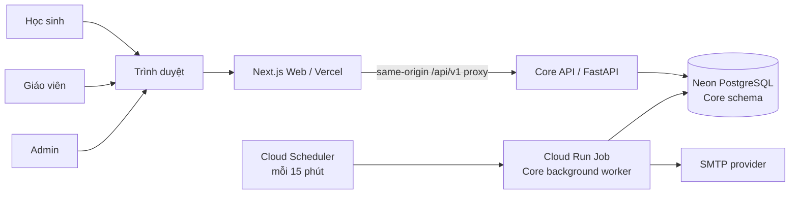
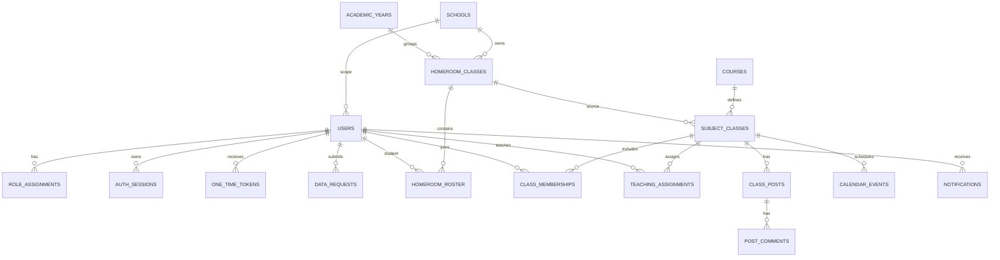
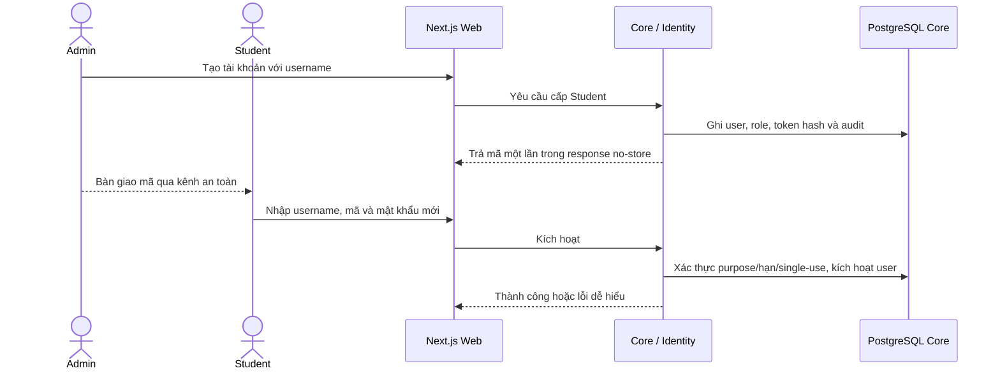

# LUMI - TÀI LIỆU THIẾT KẾ HỆ THỐNG

| Thuộc tính | Giá trị |
|---|---|
| Mã tài liệu | LUMI-SDD-001 |
| Phiên bản | 0.1 - dự thảo |
| Ngày cập nhật | 2026-10-31 |
| Trạng thái | Dự thảo, chưa phê duyệt |
| Phạm vi | Toàn hệ thống Lumi, gồm Web và năm service nghiệp vụ |

> Tài liệu này là bản thiết kế hệ thống tổng hợp. Các phần đã có thiết kế và mã triển khai được mô tả theo bằng chứng hiện hành. Các phần của service chưa được triển khai được giữ lại dưới dạng tiêu đề trống, không tự đặt schema, endpoint, công nghệ hoặc quy trình mới. Business Rules và các hợp đồng service hiện hành vẫn là nguồn chuẩn có mức ưu tiên cao hơn tài liệu tổng hợp này.

## Kiểm soát tài liệu

| Phiên bản | Ngày | Nội dung | Trạng thái |
|---|---|---|---|
| 0.1 | 2026-10-31 | Hợp nhất thiết kế hệ thống theo cấu trúc SDD; phân biệt thiết kế đã triển khai và các mục để trống | Dự thảo |

### Đối tượng sử dụng

| Đối tượng | Mục đích |
|---|---|
| Nhóm sản phẩm/PM | Kiểm tra phạm vi, quyết định nghiệp vụ, trạng thái và rủi ro |
| Kiến trúc sư/SA | Theo dõi ownership, ranh giới service và các hợp đồng liên quan |
| Lập trình viên | Hiểu luồng hệ thống, module sở hữu dữ liệu và cách triển khai hiện tại |
| QA | Xác định luồng kiểm chứng và phân biệt kết quả đo với mục tiêu |
| Vận hành | Tham khảo môi trường, triển khai, cấu hình và giới hạn đã biết |

### Quy ước trạng thái

- **Đã quyết định:** có quyết định trong Business Rules hoặc ADR.
- **Đã triển khai:** có mã trong nhánh `main`.
- **Đã kiểm chứng:** có kết quả test/CI hoặc bằng chứng môi trường được nêu cụ thể.
- **Mục tiêu:** yêu cầu hoặc ngưỡng nghiệm thu chưa có bằng chứng đạt.
- **Để trống:** phần thiết kế của service chưa được triển khai; chưa có nội dung được duyệt để mô tả.

### Tài liệu nguồn

| Tài liệu | Vai trò |
|---|---|
| [Business Rules](BUSINESS_RULES.md) | Nguồn chuẩn nghiệp vụ; không sửa rule chỉ để thuận tiện kỹ thuật |
| [ADR-001](microservices-v1/ADR-001.md) | Quyết định monorepo, năm service, ownership và cách giao tiếp |
| [Architecture v1](microservices-v1/ARCHITECTURE.md) | Baseline kiến trúc và ranh giới service |
| [Core Design](microservices-v1/core/DESIGN.md) | Thiết kế và giới hạn hiện tại của Core |
| [Core API Contract](microservices-v1/core/API_CONTRACT.md) | Hợp đồng API hiện hành của Core |
| [Quality Attributes](microservices-v1/QUALITY_ATTRIBUTES.md) | Mục tiêu chất lượng và cách nghiệm thu |
| [Implementation Roadmap](microservices-v1/IMPLEMENTATION_ROADMAP.md) | Thứ tự G0–G5 và điều kiện chuyển giai đoạn |
| [Core README](../../services/core/README.md) | Cấu hình, chạy và kiểm thử Core |
| [Core Migration Runbook](../../services/core/migrations/README.md) | Migration, seed, bootstrap và giới hạn môi trường |
| [Web Frontend Completion](../../apps/web/FRONTEND_COMPLETION.md) | Phạm vi Web, kiểm thử UI và các phụ thuộc live |

Các PDF mẫu do chủ dự án cung cấp được dùng để tham khảo cách tổ chức một SDD (kiểm soát tài liệu, tổng quan, kiến trúc, dữ liệu, giao diện, kiểm soát và kiểm thử). Nội dung nghiệp vụ và thiết kế của Lumi trong tài liệu này chỉ lấy từ các nguồn chuẩn trong repository.

## 1. Tổng quan

### 1.1 Mục đích hệ thống

Lumi là trợ giảng học tập cho học sinh THCS/THPT khối 6–12 trong lớp học chính khóa. Hệ thống hỗ trợ quản lý danh tính và lớp học, tài liệu học tập, trợ giảng AI dựa trên nguồn được cấp quyền, hoạt động đánh giá và phân tích tiến độ. Quản trị viên nhà trường quản lý tài khoản và lớp; giáo viên thực hiện hoạt động giảng dạy được phân công; học sinh sử dụng nội dung trong phạm vi lớp và quyền cá nhân của mình.

### 1.2 Phạm vi sản phẩm

- Một GitHub monorepo, một Web client và năm service nghiệp vụ: Core, Document, AI, Learning, Learner Intelligence.
- Phạm vi người dùng MVP: Admin, Lecturer (hiển thị “Giáo viên”), Student (hiển thị “Học sinh”). Nhà trường nhận báo cáo thông qua Admin, không có tài khoản riêng.
- Phạm vi học tập: lớp chính khóa THCS/THPT khối 6–12; không gồm tiểu học, đại học hoặc lớp học thêm.
- Core là service được triển khai trước. Những service chưa có triển khai được giữ trong cấu trúc tài liệu nhưng phần thiết kế chi tiết để trống.
- Môi trường Production hiện dùng trường tổng hợp `Lumi Mock School`; đây là môi trường đồ án, không phải trường đối tác hay dữ liệu học sinh thật.

### 1.3 Ngoài phạm vi thiết kế hiện tại

- Chi tiết kỹ thuật, schema, endpoint hoặc hạ tầng cho Document, AI, Learning và Learner Intelligence chưa được chốt trong repository; các chương tương ứng để trống.
- Không khẳng định hệ thống đã nghiệm thu toàn Core G2, full TP-01 hoặc chất lượng RAG.
- Không xác định thời hạn retention theo luật hoặc cam kết pháp lý. DELETE liên service tiếp tục chờ chính sách và executor được duyệt.
- Các bảng/API cũ về join code, Student self-registration, co-lecturer invitation hoặc chuyển ownership không thuộc baseline MVP.

### 1.4 Thuật ngữ

| Thuật ngữ | Diễn giải |
|---|---|
| Core | Một FastAPI service gồm nhiều module nội bộ; không phải một microservice cho mỗi module |
| Web/BFF | Next.js Web và route proxy same-origin `/api/v1` |
| AUTO | Ghi danh lớp môn học đồng bộ theo roster lớp hành chính |
| MANUAL | Roster lớp môn học do Admin quản lý |
| PRIMARY / ASSISTING | Vai trò phân công giáo viên trong lớp; không phải role hệ thống mới |
| Outbox | Bảng sự kiện cùng transaction với thay đổi nghiệp vụ, được worker xử lý sau commit |
| Mock School | Dữ liệu tổng hợp dùng cho demo/đồ án; không phải nguồn roster thật |

## 2. Yêu cầu và nguyên tắc thiết kế

### 2.1 Mục tiêu

1. Tạo một nguồn chuẩn cho thiết kế hệ thống và trạng thái triển khai.
2. Giữ ownership dữ liệu theo service; consumer chỉ dùng public API/interface được duyệt.
3. Xác minh quyền tại backend theo role hiện hành, school, lớp và tài nguyên.
4. Bảo vệ riêng tư học sinh, chat AI, tài liệu nguồn, token và dữ liệu đăng nhập.
5. Cho phép triển khai service độc lập khi từng service có hợp đồng và vận hành riêng.
6. Ghi rõ mục tiêu, kết quả đo, giới hạn và phần chưa thiết kế; không đồng nhất tài liệu mục tiêu với tính năng đã chạy.

### 2.2 Nguyên tắc

- **Business Rules trước:** mọi thiết kế phải tuân theo [Business Rules](BUSINESS_RULES.md).
- **Fail closed:** khi không xác minh được danh tính, school scope, membership hoặc grant, thao tác nhạy cảm bị từ chối.
- **Ownership:** một service sở hữu schema và nghiệp vụ của mình; không import repository/model nội bộ hoặc query bảng của service khác.
- **Permission tại điểm sử dụng:** không coi role trong JWT, URL, metadata lớp hoặc quyền lịch sử là quyền hiện hành cho mọi action.
- **Migration có phiên bản:** thay đổi schema tạo revision mới; không sửa migration đã áp dụng.
- **Không log bí mật:** không đưa password, token, nội dung chat riêng tư hoặc nguyên văn tài liệu vào log/audit.
- **Bằng chứng trước nghiệm thu:** test hữu hạn không chứng minh không còn lỗi; không tuyên bố KPI nếu chưa đo đúng môi trường và phạm vi.

## 3. Người dùng và trách nhiệm

| Vai trò/kênh | Trách nhiệm chính | Ranh giới quyền |
|---|---|---|
| Admin | Cấp tài khoản, quản lý roster/lớp/phân công, xử lý audit và yêu cầu dữ liệu | Không mặc định được đọc chat AI riêng tư; mutation theo school scope, có audit |
| Lecturer / Giáo viên | Quản lý hoạt động của lớp được phân công, tài liệu và đánh giá trong quyền hiện hành | Không tạo lớp, sửa roster, phân công giáo viên hoặc tự chuyển quyền chủ lớp |
| Student / Học sinh | Kích hoạt username, học và xem dữ liệu cá nhân trong lớp được phép | Không tự đăng ký, tự join hoặc rời lớp chính khóa; học sinh không cần email |
| Vận hành | Triển khai, migration, secrets, worker, health và ứng phó sự cố | Bootstrap Production chỉ chạy thủ công theo runbook; không public bootstrap endpoint |

Các quy tắc chi tiết về phân công, chuyển lớp, điểm, tài liệu và retention được quy định trong Business Rules; bảng trên chỉ là tóm tắt kiến trúc quyền.

## 4. Kiến trúc tổng thể

### 4.1 Sơ đồ ngữ cảnh triển khai hiện tại

Next.js proxy chuyển tiếp các thao tác đã allowlist. Trình duyệt không gọi trực tiếp hostname nội bộ của Core và không nhận service credential. API Core public ở mức network để Web gọi được; authorization vẫn do Core thực hiện theo từng route.

### 4.2 Hệ thống service

| Service | Thiết kế hiện hành |
|---|---|
| Core | Identity, lớp/roster, Social, Notification và Administration; chi tiết tại mục 5.1 |
| Document |  |
| AI |  |
| Learning |  |
| Learner Intelligence |  |

Web là client, không phải service nghiệp vụ thứ sáu. Notification/credential worker là tiến trình nền của Core, không phải microservice riêng.

### 4.3 Kiến trúc runtime Core hiện có

Core là modular monolith FastAPI: một API runtime lắp ghép các module Identity, Classroom, Social, Notification, Administration, Health và Common. Module boundary nội bộ được bảo vệ bằng public interface. Các phần lõi gồm:

- Common: settings, SQLAlchemy session/transaction, auth dependencies, error envelope, rate limits, admission gate, audit và outbox.
- Identity: user/role/session, Student activation/recovery, staff invitation/reset, School scope và data requests.
- Classroom: School, AcademicYear, Semester, Homeroom/Roster, Course/SubjectClass, Membership, TeachingAssignment và access checks.
- Social: feed, comments và calendar; deadline chính thức do Learning sở hữu, Core chỉ giữ projection theo contract.
- Notification: inbox, recipient isolation, outbox event validation, dedup, retry/backoff.
- Administration: staff/role/status, audit API, Student CSV/XLSX import preview/confirm và data-request workflow.
- Maintenance: migration checks, school mapping report/plan/apply, seed dev/test và guarded bootstrap operator.

### 4.4 Kiến trúc Web hiện có

- Next.js App Router, TypeScript và React. Route handler `/api/v1` là BFF/proxy cùng origin đến Core.
- Live build dùng live adapter; mock chỉ dùng trong môi trường phát triển được bật tường minh. Production build không chấp nhận mock adapter và scan bundle để chặn fixture marker.
- Các thao tác live chưa có contract trả trạng thái unavailable; không fallback sang fixture khi API lỗi.
- Access token chỉ giữ trong bộ nhớ trình duyệt; refresh token nằm trong cookie HttpOnly. Web giữ state/lifecycle giao diện; Core vẫn là nguồn authorization.

## 5. Thiết kế service

### 5.1 Core

Đặc tả module, API, state machine và folder ownership chi tiết tại [Core Design](microservices-v1/core/DESIGN.md), [Core API Contract](microservices-v1/core/API_CONTRACT.md) và [Folder Structure](microservices-v1/core/FOLDER_STRUCTURE.md). Phần dưới đây tóm tắt những quyết định xuyên hệ thống; tài liệu đó là nguồn chi tiết.

**Stack:** Python 3.12, FastAPI, SQLAlchemy 2, Alembic, PostgreSQL 16+, Docker Compose; Web Next.js 15/React 19. Dependencies và phiên bản chính thức nằm trong `services/core/pyproject.toml`, `apps/web/package.json` và lockfile.

**API:** versioned REST/JSON dưới `/api/v1`; error envelope có `code`, thông báo tự nhiên và `correlation_id`. Pagination dùng cursor; input được validate ở server. OpenAPI snapshot kiểm tra contract Identity.

**Transaction:** module sở hữu mutation và transaction. Các event cần phát được ghi qua transactional outbox trong transaction nghiệp vụ; lỗi consumer không rollback mutation đã commit. Mutation quan trọng dùng lock/version/preview và idempotency theo contract.

**Worker:** `app.background_worker` gọi Notification worker và Identity credential-delivery worker trong cùng image. Worker xử lý batch, không thêm schema hay service ownership mới.

**Schema/migrations:** schema PostgreSQL `core`; migrations là lịch sử schema có phiên bản. Repository hiện có revision 0014 `users.school_id` nullable FK tới School. Migration không tự đoán hoặc backfill school mapping cũ. Database Production theo runbook dùng `Lumi Mock School`; dữ liệu thật cần nguồn mapping có thẩm quyền.

### 5.2 Document

### 5.3 AI Tutor

### 5.4 Learning

### 5.5 Learner Intelligence

## 6. Thiết kế dữ liệu và sở hữu dữ liệu

### 6.1 Ranh giới dữ liệu

| Dữ liệu | Service sở hữu | Quy tắc truy cập |
|---|---|---|
| User, role, session, tokens, School scope | Core / Identity | Role/status/session version được kiểm tra hiện hành ở backend |
| School, năm học, học kỳ, roster, lớp môn học, assignment | Core / Classroom | School và resource scope; không dựa vào dữ liệu do browser gửi để cấp quyền |
| Feed, comment, Core calendar event, in-app notification | Core / Social, Notification | Kiểm tra action và membership/teaching assignment hiện hành |
| Core audit, data request, import result, credential delivery/outbox | Core / Administration, Identity, Common | Audit tối thiểu; token/secret không được lưu ở dạng đọc được |

### 6.2 Mô hình logic Core

Sơ đồ là mô hình logic rút gọn, không thay thế metadata/migrations. Các bảng và constraint thật được định nghĩa bởi Alembic revisions. Core không dùng foreign key hoặc SQL trực tiếp sang database/schema do service khác sở hữu.

### 6.3 Quy ước dữ liệu và migration

- Primary key UUID; mốc thời gian lưu dạng timezone-aware UTC.
- Password, refresh token và one-time token lưu hash; email credential payload chỉ tồn tại trong luồng delivery được bảo vệ.
- Audit metadata dùng allowlist cấu trúc; không ghi nội dung chat, token, password hoặc nguyên văn tài liệu.
- `school_id` là nullable cho legacy transition; constraint FK không đồng nghĩa với việc tài khoản cũ đã được ánh xạ đúng trường.
- Mọi schema change tạo migration mới, chạy upgrade + `alembic check`, có PostgreSQL test. Không sửa revision đã áp dụng.
- Database dev/test chỉ được seed bằng CLI guarded. Production bootstrap là job offline operator-triggered, không phải HTTP endpoint hoặc startup seed.

### 6.4 Retention, deletion và data request

Core nhận ACCESS, EXPORT, CORRECTION và DELETE requests. ACCESS/EXPORT/CORRECTION theo workflow Admin hiện tại; việc giao bản sao thủ công qua kênh an toàn được xác nhận/audit, CORRECTION do service sở hữu hoàn tất. DELETE giữ `IN_REVIEW` cho đến khi có retention policy và executor được duyệt cho dữ liệu xuyên service. Không xem database cascade là chính sách xóa sản phẩm.

Thời hạn retention cụ thể, căn cứ pháp lý, xử lý backup và xác nhận xóa xuyên service chưa được chốt trong nguồn chuẩn; không thêm thời hạn vào tài liệu này.

## 7. Luồng nghiệp vụ và tương tác

### 7.1 Cấp và kích hoạt tài khoản học sinh

Student không cần email. Mã mặc định có hạn 24 giờ theo cấu hình; khôi phục mật khẩu cũng do Admin xác minh và cấp mã. Student credentials không gửi SMTP.

### 7.2 Lời mời và khôi phục tài khoản nhân sự

Core lưu token hash và delivery record; worker gửi email invitation/password-reset với link tới `PUBLIC_WEB_URL/staff/invitation` hoặc `/reset-password`. Token nằm trong URL fragment để tránh gửi token trong HTTP request URL; Web tự điền token và loại khỏi thanh địa chỉ trước khi submit. Email có mã xác thực dự phòng. Việc gửi mail là riêng với commit nghiệp vụ; retry dùng cùng token, Admin chủ động reissue mới vô hiệu token cũ.

`PUBLIC_WEB_URL` cần là origin HTTPS trong môi trường thật, dùng chung cho API và worker. Production hiện đã cấu hình biến này thành origin Vercel Production; nội dung thư mới chưa được xác nhận bằng email thật sau deploy.

### 7.3 Quản lý lớp và thông báo

Admin tạo School configuration, homeroom/roster, course, subject class, teacher assignment và enrollment mode. AUTO đồng bộ theo roster; MANUAL chỉ thay đổi theo lệnh Admin. Mutations có quyền hiện hành, preview/version checks, audit và outbox event khi cần. Worker phát inbox notification tới recipient snapshot; dedup/retry không đọc payload tùy ý và không gửi credential vào inbox.

### 7.4 Các luồng của service còn lại

## 8. Giao diện và hợp đồng tích hợp

### 8.1 Web - Core

- Browser gọi same-origin `/api/v1`; route handler Web forward allowlisted Core paths bằng server-only `CORE_API_URL`.
- `WEB_ORIGIN` là browser-facing origin chính xác; Core `CORS_ORIGINS` phải khớp origin đó. Cookie mutations xác minh Origin.
- Web validate DTO phản hồi; API down, sai response hoặc contract mismatch không được fallback sang fixture.
- `NEXT_PUBLIC_DATA_MODE=mock` chỉ dành cho phát triển/preview tường minh; production build/start từ chối mock.

### 8.2 Core API và service boundaries

Contract endpoint, payload, error code, permission, pagination, idempotency và migration compatibility tại [Core API Contract](microservices-v1/core/API_CONTRACT.md). Internal service access check dùng service credential + scope; browser token không thay thế service auth. Module Core giao tiếp qua `public.py`, không dùng repository/model chéo module.

### 8.2.1 Document API

### 8.2.2 AI API

### 8.2.3 Learning API

### 8.2.4 Learner Intelligence API

### 8.3 Giao tiếp bất đồng bộ trong Core

Transactional outbox nằm trong PostgreSQL Core. Producer ghi business mutation, event version và recipient snapshot trong cùng transaction; worker consume có validation, idempotency/dedup và retry/backoff. Core hiện không khai báo một message broker riêng. Event/API liên service ngoài những contract đang tồn tại được để trống cho service owner thiết kế.

## 9. An toàn thông tin và riêng tư

### 9.1 Xác thực và phiên

- Password hash dùng Argon2id; access JWT 15 phút, refresh session 7 ngày theo cấu hình hiện hành.
- Refresh cookie HttpOnly, Secure ngoài local development, SameSite=Lax; access token chỉ giữ trong memory của Web.
- Refresh rotation, logout-all, đổi mật khẩu và khóa tài khoản thu hồi session hiện hành; reuse token revoked thu hồi family theo Identity contract.
- Staff dùng email login; Student dùng username. Public Student registration bị chặn.
- Internal service credentials và signing secrets lưu trong Secret Manager ở cloud; không lưu secret trong repository, image hoặc browser bundle.

### 9.2 Authorization và tenant

Authorization thực hiện tại backend cho mỗi action: trạng thái user, role hiện hành, school scope, class membership/teaching assignment và grant tài nguyên. `school_id` từ request/JWT không được dùng như nguồn phân quyền. Khi không đủ căn cứ, trả từ chối an toàn và không làm lộ resource ngoài scope.

Admin không mặc định đọc chat AI riêng tư. Khi student chuyển lớp hoặc lớp archived, hoạt động mới bị chặn theo rule; quyền đọc lịch sử cá nhân và tài liệu nguồn được kiểm tra riêng.

### 9.3 Audit, log và dữ liệu nhạy cảm

- Audit ghi actor/resource/action/time/school và metadata allowlist; Web hiển thị nhãn dễ hiểu thay mã hành động.
- Error envelope giữ `code` ổn định cho client nhưng `message` hướng dẫn bằng tiếng Việt tự nhiên; không trả stack trace, SQL detail hoặc exception text không kiểm soát.
- Worker log trạng thái xử lý bằng ngôn ngữ rõ ràng; token, email nhận thư, payload thông báo và provider error detail không ghi vào log.
- Phạm vi retention cho audit, credential delivery, chat, files, submissions, backups và data request chưa được phê duyệt đầy đủ; mục này không tạo thời hạn mới.

### 9.4 Threat boundaries

| Mối đe dọa | Kiểm soát hiện hành |
|---|---|
| Giả mạo school/class/resource ID | Authorization theo DB hiện hành và resource-scoped checks |
| CSRF qua refresh cookie | Origin validation cho cookie mutations; Web same-origin proxy |
| Rò rỉ token/password | Hash at rest, no-store responses, fragment link, secret manager, log redaction |
| Phát lại mutation | Idempotency theo contract; one-time tokens single-use; worker dedup |
| Mất database | Readiness kiểm tra DB; backup/restore RPO/RTO cần runbook/vận hành xác nhận |
| Quyền tài liệu bị thu hồi | Consumer phải kiểm tra grant hiện hành tại lần truy cập mới |

## 10. Mô hình triển khai

### 10.1 Môi trường

| Môi trường | Web | Core/API | Database | Worker | Mục đích |
|---|---|---|---|---|---|
| Local | Next.js | Docker Compose Core | PostgreSQL 16 container/local volume | Core background worker | Phát triển và integration smoke |
| Preview / staging | Vercel Preview | Cloud Run Core theo cấu hình staging | Neon staging riêng | Cloud Run Job + Scheduler | Kiểm thử dùng dữ liệu tổng hợp |
| Production mock | Vercel Production | Cloud Run `lumi-core-api-production` | Neon Production riêng, PostgreSQL 16, Singapore | Cloud Run Job `lumi-production-notification-worker`, Scheduler 15 phút | Demo đồ án `Lumi Mock School`; không dùng dữ liệu học sinh thật |

Staging và Production dùng database/secret riêng. Không chạy seed dev/test trên hai môi trường này.

### 10.2 Local Compose

Compose tạo `db`, `migrate`, `core`, `notification-worker` và `web`. Migration phải hoàn thành trước Core/worker; database port và API/Web port chỉ bind `127.0.0.1`. Container Core chạy non-root, read-only root filesystem, `/tmp` tmpfs, drop capabilities và `no-new-privileges`. Chi tiết ports/environment xem `.env.example`, `compose.yaml` và [Core README](../../services/core/README.md).

### 10.3 Cloud runtime hiện hành

- Core API scale-to-zero, tối đa 3 instances, một Uvicorn worker mỗi instance; API invoker public để Web gọi được, nhưng routes nghiệp vụ vẫn áp dụng auth/authorization.
- `SECRET_KEY`, internal-service secret, database URLs và SMTP password chỉ tham chiếu Secret Manager.
- Migration/schema check là operator-triggered Cloud Run Jobs dùng direct database URL; API/worker dùng runtime pooled URL theo runbook.
- Cloud Scheduler gọi một batch worker mỗi 15 phút theo `Asia/Ho_Chi_Minh`; đây không phải chu kỳ một email cố định mà là chu kỳ quét/xử lý các item đang đến hạn.
- Production bootstrap Admin là job thủ công có environment confirmation và kiểm tra DB/schema/marker; không có route HTTP bootstrap.
- Production Core được deploy từ `main` commit `a01985e`, image tag `production-mock-a01985e`, revision `lumi-core-api-production-00002-7jm`; readiness đã xác nhận PostgreSQL kết nối. API và notification job đã nhận `PUBLIC_WEB_URL` là origin Vercel Production. Chưa gửi email thật sau deploy; khi kiểm tra nội dung thư cần chủ động yêu cầu invitation/reset mới.

### 10.4 Cấu hình quan trọng

| Biến | Nơi dùng | Yêu cầu |
|---|---|---|
| `DATABASE_URL` | Core API/worker | Database riêng theo môi trường; URL-encode ký tự đặc biệt |
| `SECRET_KEY` | Core auth/token derivation | Secret tối thiểu 32 ký tự, Secret Manager ở cloud |
| `INTERNAL_SERVICE_SECRET` | Internal access checks | Secret riêng, không đưa vào Web |
| `CORE_API_URL` | Next server proxy | URL upstream Core; server-side only |
| `WEB_ORIGIN`, `CORS_ORIGINS` | Web/Core | Exact browser origin; HTTPS trong môi trường thật |
| `PUBLIC_WEB_URL` | Core API/worker email | Origin Vercel tương ứng; không phải secret |
| `SMTP_*` | Credential delivery worker/API | SMTP TLS; password lấy từ Secret Manager ở cloud |
| `STUDENT_ACTIVATION_EXPIRE_HOURS` | Identity | Mặc định 24 giờ; mã Student không gửi email |

Không ghi giá trị secret trong tài liệu, lệnh, commit, issue hoặc log.

## 11. Vận hành, độ tin cậy và phục hồi

### 11.1 Health và migration

- `/health/live` phản ánh process sống; không thay thế readiness.
- `/health/ready` kiểm tra PostgreSQL; DB unavailable thì trả lỗi service unavailable, liveness vẫn hoạt động.
- Compose migration service chạy Alembic trước API/worker. CI chạy upgrade, drift check, head check, full PostgreSQL tests và smoke.
- Migration downgrade được guard; xem [Core migration runbook](../../services/core/migrations/README.md) trước khi thực hiện ở environment có dữ liệu.

### 11.2 Worker và retry

Notification và credential email được xử lý từ queue/outbox của Core; consumer transaction riêng, dedup/retry có giới hạn. SMTP retry giữ cùng one-time token khi còn hiệu lực. Reissue invitation là thao tác Admin riêng và vô hiệu token trước đó. Worker không log token, recipient hoặc raw provider error.

### 11.3 Scale và giới hạn hiện tại

Rate limiter và phần non-import idempotency state hiện process-local. Runtime giữ một worker trong mỗi instance; tăng số worker trong process chưa được hỗ trợ. Cloud Run nhiều instances vẫn tạo state cục bộ riêng, nên limit/idempotency toàn hệ thống không được xem là global. Shared durable store cần được thiết kế/kiểm chứng trước khi tăng scale vượt mô hình MVP.

### 11.4 Backup và disaster recovery

RPO, RTO, lịch backup/restore test và quy trình phục hồi cross-service chưa được chốt trong tài liệu vận hành hiện tại. Không đưa ra cam kết backup hoặc SLA khi chưa có evidence.

## 12. Quality attributes và kiểm chứng

Các con số sau phân biệt **mục tiêu** với **bằng chứng đo**. Mục tiêu chất lượng chi tiết ở [Quality Attributes](microservices-v1/QUALITY_ATTRIBUTES.md).

| Thuộc tính | Mục tiêu/điều kiện | Trạng thái bằng chứng |
|---|---|---|
| Availability/fault isolation |  |  |
| Data integrity | Mutation/retry không sinh duplicate/mất dữ liệu; event có version/dedup | Core PostgreSQL CI có integration/concurrency tests |
| Security/privacy | Unauthorized/cross-school/cross-class fail closed; không lộ chat/token | Core API security/permission tests trong CI; chưa phải kiểm thử xâm nhập độc lập |
| Core performance | QAS-05: Core class list backend p95 ≤500 ms trong TP-01; 99% request thành công | Core-06 subset đo riêng ở dưới; không phải full TP-01 |
| RAG quality |  |  |
| Recovery |  |  |
| Deployability | Mỗi service độc lập build/test/deploy | Core/Web có pipeline |

### 12.1 Bằng chứng Core-06

VPS CKEY, PostgreSQL 16.15, Python 3.12.16, 100 users, 10 classes × 50 Student, 30 giây warm-up + 600 giây đo: 58.521/58.521 HTTP 200, scope mismatch 0, backend p95 21,84 ms, client loopback p95 672,04 ms. Harness đánh dấu Core threshold đạt.

Giới hạn: host CKEY là máy nhà cung cấp chia sẻ, không đo được mức cô lập CPU/RAM; client p95 là loopback, không đại diện latency trình duyệt, Cloud Run hoặc Neon. Bài đo không tải Document, AI, Learning hay Learner Intelligence và `full_tp01_verified=false`. Chi tiết aggregate report nằm tại [Core-06 evidence](../../services/core/test-evidence/task015/core-load-ckey-2026-10-30.json).

### 12.2 Pipeline và kiểm thử

- `npm run check`: boundaries, TypeScript và Web behavioral tests; `npm run build`: production build và release fixture scan.
- Core CI: Ruff lint/format, PostgreSQL 16 migration/drift check, OpenAPI snapshot, full Core tests/coverage/security evidence, Web build và Compose smoke.
- CI của PR #38 đã pass trên commit cuối đã merge. Test local trong môi trường không có `TEST_DATABASE_URL` bỏ qua các integration PostgreSQL; không dùng kết quả local này thay CI.
- `core-load` là workflow dispatch riêng, không chạy mặc định trong PR.

## 13. Hiện trạng và phần cần hoàn thiện

### 13.1 Core

Core backend và Web MVP đã được tích hợp vào `main` qua PR #38. API, migrations, Docker/CI, worker và Web build có CI evidence. Điều đó xác nhận các gates đã chạy đạt; không đồng nghĩa nghiệm thu full TP-01 hoặc toàn bộ nghiệp vụ liên service.

### 13.2 Dữ liệu và chính sách

- Production hiện là Mock School, không dùng dữ liệu học sinh thật.
- Mapping school cho tài khoản thực cần nguồn roster/manifest có thẩm quyền; UUID synthetic chỉ dùng trong DB dev/test.
- DELETE/retention cross-service tiếp tục deferred đến khi có policy và executor được duyệt.
- Email link template đã được deploy lên Core API và notification worker; cần yêu cầu invitation/reset mới để kiểm tra email thật, không dùng lại thư cũ.

### 13.3 Dịch vụ chưa triển khai

## 14. Quản lý thay đổi thiết kế

1. Thay đổi nghiệp vụ phải được duyệt theo Business Rules, cập nhật Rule ID bị ảnh hưởng và tài liệu service tương ứng.
2. Thay đổi API/schema/permission/event phải cập nhật contract, migration (nếu có), test và owner impact.
3. Không mô tả endpoint/schema/hạ tầng của service chưa được thiết kế như quyết định đã chốt.
4. Khi có bằng chứng deployment/test mới, cập nhật trạng thái và ngày kiểm chứng; không xoá bỏ giới hạn của kết quả đo.
5. PR thay đổi tài liệu phải nêu nguồn chuẩn nào được cập nhật và giữ liên kết giữa SDD, ADR, service contract, runbook và tests.

## 15. Tài liệu tham khảo

### 15.1 Nguồn nội bộ Lumi

- [Business Rules](BUSINESS_RULES.md)
- [ADR-001](microservices-v1/ADR-001.md)
- [Architecture v1](microservices-v1/ARCHITECTURE.md)
- [Core Design](microservices-v1/core/DESIGN.md)
- [Core API Contract](microservices-v1/core/API_CONTRACT.md)
- [Quality Attributes](microservices-v1/QUALITY_ATTRIBUTES.md)
- [Implementation Roadmap](microservices-v1/IMPLEMENTATION_ROADMAP.md)
- [Core README](../../services/core/README.md)
- [Migration/deployment runbook](../../services/core/migrations/README.md)
- [Web frontend design and backend handoff](../../apps/web/docs/FRONTEND.md)
- [Frontend completion evidence](../../apps/web/FRONTEND_COMPLETION.md)

### 15.2 Mẫu cấu trúc được tham khảo

Các tài liệu sau chỉ dùng làm tham khảo cấu trúc SDD; không phải nguồn yêu cầu hoặc nguồn sự thật cho Lumi:

1. *Information Management Platform for Data Analytics and Aggregation (IMPALA) System Design Document*, HHPC 10061, NASA/JSC, August 2016.
2. *Federal Digital System (FDsys) System Design Document, Volume I: System Architecture*, R1C2 Edition, September 2008.
3. *Mẫu Tài Liệu Thiết Kế Hệ Thống Dự Án, Phiên Bản 1.0*.
