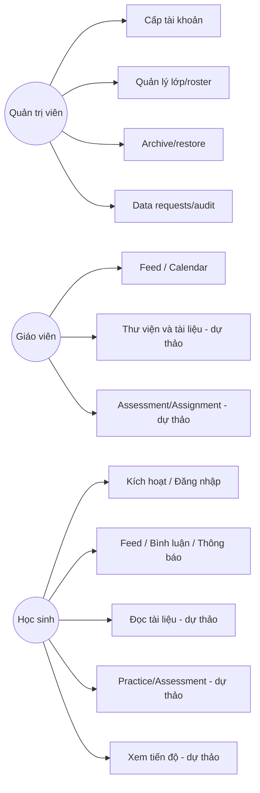

# USE CASES — KỊCH BẢN TƯƠNG TÁC NGƯỜI DÙNG

**Mã:** LUMI-UC-001 · **Trạng thái:** Core workflow từ contract hiện hành; Document/Learning/Intelligence là thiết kế PROPOSED.

## 1. Quy ước use case

Mỗi UC gồm mục tiêu, actor, điều kiện trước, luồng chính, ngoại lệ, hậu điều kiện, rule và test. Thứ tự bước mô tả hành vi, **không phải cam kết về thứ tự câu lệnh SQL**. Backend là nguồn quyết định quyền; UI không thể cấp quyền độc lập.

## UC-01 — Admin cấp tài khoản Student và Student kích hoạt

- **Actor:** Admin, Student. **Rule:** F1, K2. **FR:** FR-ID-01/02/03. **Test:** TC-004/005/006.
- **Tiền điều kiện:** Admin ACTIVE đã được xác thực, có school scope; username chưa được dùng.

**Luồng chính:**
1. Admin mở trang tạo học sinh, nhập username/display_name.
2. Web gửi `POST /admin/students` theo phiên Admin.
3. Core xác minh Admin/school, khóa/unique username, ghi User PENDING, Student role, one-time token hash và audit trong transaction.
4. Core trả mã và hạn một lần với no-store; Admin bàn giao an toàn.
5. Student mở trang kích hoạt, nhập username, mã và mật khẩu.
6. Core kiểm tra hash/purpose/hạn/unused và tình trạng user, kích hoạt và đánh dấu consumed.
7. Student đăng nhập bằng username/password, Web đọc `/users/me` và mở dashboard đúng role.

**Ngoại lệ:** (A) username trùng → 409/422 theo schema; không tạo user. (B) mã sai/expired/replay → 400, không kích hoạt. (C) khóa tài khoản → không mở tự động. (D) client timeout sau cấp mã → không cấp lại mù; Admin xác minh user/status trước reissue.

**Hậu điều kiện:** Student ACTIVE đúng trường; credential code không còn dùng được; audit không lộ mã.

## UC-02 — Staff invitation và khôi phục

- **Actor:** Admin, Lecturer. **FR:** FR-ID-03/04/05.
- **Tiền điều kiện:** SMTP/operator config được xác định; Admin trong trường.

**Luồng chính:**
1. Admin tạo staff bằng email và role ADMIN/LECTURER.
2. Core commit user/token hash/credential delivery record, trả delivery status.
3. Worker gửi email có liên kết tới Web, token nằm trong fragment; không đặt token trong query string/log.
4. Lecturer mở link, Web lấy token và xóa fragment khỏi thanh địa chỉ trước khi submit.
5. Core xác minh token một lần, đặt mật khẩu và cập nhật trạng thái theo contract.

**Ngoại lệ:** email lỗi → PENDING/NEEDS_REISSUE theo status; retry có kiểm soát. Admin reissue invitation làm token cũ vô hiệu. User LOCKED không bị mở chỉ nhờ reset.

## UC-03 — Admin nhập roster học sinh

- **Actor:** Admin. **Rule:** F1/F2/A1. **FR:** FR-ID-06/FR-CL-02. **Test:** TC-009/010.

**Luồng chính:** Chọn file và mapping → preview server validation → xem chi tiết từng dòng và homeroom đích → confirm theo preview_id → Core import atomically và reconcile → hiển thị outcome theo từng row.

**Ngoại lệ:** preview expired/stale roster; duplicate username; user_id legacy khác trường; concurrent import; mất response sau commit. Trong trường hợp unknown response, GET trạng thái batch thay vì gửi lại mù.

**Hậu điều kiện:** không nhân đôi accounts/roster, các lỗi vẫn có nguyên nhân rõ, code nhạy cảm không lộ.

## UC-04 — Admin tạo lớp môn học AUTO

- **Actor:** Admin. **Rule:** A1/A3/A7/A8. **FR:** FR-CL-01/02/05. **Test:** TC-013/014.

**Luồng chính:** Admin tạo course/homeroom/roster → chọn course, grade, academic year, semester, homeroom, PRIMARY, mode AUTO → Core kiểm tra school và assignment → ghi class + assignments atomically → đồng bộ membership theo roster đúng contract → Admin xem trang quản lý lớp.

**Ngoại lệ:** course/homeroom/teacher không cùng trường, PRIMARY thiếu, roster version stale, school scope null. Không cho Lecturer tạo lớp qua API kể cả khi UI bị thao túng.

## UC-05 — MANUAL→AUTO với preview chống ghi đè

- **Actor:** Admin. **Rule:** A1/A4. **FR:** FR-CL-02/03. **Test:** TC-015.

**Luồng chính:** Admin xem membership hiện có → yêu cầu preview để biết add/end → nhận class_version/roster_version → confirm đổi mode/sync → backend khóa/kiểm tra version và ghi changes + audit + event cùng transaction.

**Ngoại lệ:** roster thay sau preview → 409, UI phải preview lại. MANUAL class không tự động bị sync bởi thay roster ngoài quy trình.

## UC-06 — Chuyển lớp và quyền lịch sử

- **Actor:** Admin, Student, Lecturer. **Rule:** A4/L2/M1/O4. **FR:** FR-CL-04/07, FR-LE-08. **Test:** TC-016/019 và LE-T19.

**Luồng chính:** Admin chọn chuyển lớp hợp lệ → Core cập nhật source/destination membership episode, giữ dấu thời gian/nguồn → thu hồi quyền tham gia hoạt động mới lớp cũ → quyền xem kết quả cá nhân/bài đã nộp được Learning thực thi khi service có contract.

**Ngoại lệ:** chuyển giữa trường, năm/khối/môn không hợp lệ; attempt đang dở (PENDING policy); stale version; teacher cố gắng chuyển lớp.

## UC-07 — Giáo viên đăng hoạt động và Student bình luận

- **Actor:** Lecturer, Student. **Rule:** G1/G2/L1/L5. **FR:** FR-SO-01/02. **Test:** TC-020/021.

**Luồng chính:** Lecturer mở lớp đang được phân công → tạo post → Core kiểm tra class/action và lưu post/outbox snapshot → Student đang enrolled xem post → bình luận → author/teacher có thể xử lý theo quyền → xóa mềm ẩn nội dung khỏi feed.

**Ngoại lệ:** lớp archived, membership ended, post deleted, khác lớp, moderator trái quyền; 401/403/404 được thể hiện rõ.

## UC-08 — Lịch học của lớp và thông báo trong ứng dụng

- **Vai trò:** Giáo viên, Học sinh. **Quy tắc:** G3/G4. **Yêu cầu:** FR-SO-03, FR-NO-01/02. **Kiểm thử:** TC-022–TC-024.
- **Phạm vi:** Hai chức năng đã triển khai nhưng có cơ chế xử lý riêng. Không coi thao tác tạo lịch của lớp là nguyên nhân tự động phát sinh thông báo.

**Luồng A — Tạo và xem lịch lớp (ĐÃ TRIỂN KHAI):** Giáo viên đang được phân công mở lớp → nhập tiêu đề, thời gian bắt đầu và kết thúc, bảo đảm thời gian bắt đầu trước thời gian kết thúc → Core xác minh quyền quản lý lịch và lưu sự kiện thuộc nguồn `CORE` → thành viên còn quyền truy cập mở lịch để xem sự kiện. Thao tác tạo, sửa hoặc xóa sự kiện lịch nguồn `CORE` hiện **không ghi sự kiện vào hàng đợi thông báo và không tự tạo thông báo trong hộp thư**.

**Luồng B — Nhận thông báo từ hoạt động có hỗ trợ phát thông báo (ĐÃ TRIỂN KHAI):** Người dùng có quyền tạo bài đăng hoặc bình luận trong lớp → Core ghi thay đổi nghiệp vụ và sự kiện thông báo kèm danh sách người nhận tại cùng giao dịch → tiến trình xử lý nền tiếp nhận, chống gửi trùng và tạo thông báo trong hộp thư người nhận → người nhận xem, mở tài nguyên sau khi hệ thống kiểm tra lại quyền hiện hành và đánh dấu đã đọc.

**Luồng C — Đồng bộ hạn nộp từ dịch vụ Learning (CHƯA TÍCH HỢP):** Core có cơ chế nội bộ tiếp nhận bản chiếu hạn nộp, có thể ghi sự kiện `CALENDAR_DEADLINE_CHANGED` khi nhận thay đổi hợp lệ. Tuy nhiên, hợp đồng và luồng gọi từ Learning chưa được triển khai; không mô tả đây là thông báo hạn nộp đã hoạt động xuyên dịch vụ. Việc tự thông báo khi tạo lịch nguồn `CORE`, nếu cần, phải được đề xuất và phê duyệt riêng.

**Ngoại lệ và kiểm soát:** Khoảng thời gian không hợp lệ bị từ chối; người không có quyền không thể sửa lịch. Đối với những nghiệp vụ có phát thông báo, tiến trình nền phải xử lý thử lại an toàn, không nhân đôi thông báo; không tự đưa thành viên tham gia sau sự kiện vào danh sách người nhận lịch sử; sự kiện cũ thiếu danh sách người nhận không được phát lại dựa trên thành viên hiện tại.

## UC-09 — Archive và restore lớp

- **Actor:** Admin. **Rule:** F5/M5/O2. **FR:** FR-CL-06. **Test:** TC-017/018.

**Luồng chính:** Admin nhận diện lớp ACTIVE → confirm archive với expected version → Core archive, event/audit → UI teacher/student chuyển trạng thái chỉ đọc → Admin restore với kiểm tra quyền/status hiện hành.

**Ngoại lệ:** class version stale, teacher tự archive, student tạo post sau archive, user mất assignment sau restore.

## UC-10 — Người dùng yêu cầu dữ liệu cá nhân

- **Actor:** Student/Staff, Admin/operator. **Rule:** F4/K1–K6/O8. **FR:** FR-ID-07. **Test:** TC-025/026.

**Luồng chính:** User gửi loại ACCESS/EXPORT/CORRECTION/DELETE → Core intake PENDING → Admin cùng trường xác minh và phân loại → nếu có policy/executor được duyệt, thực hiện qua nguồn sở hữu → audit completion với evidence; nếu chưa, giữ IN_REVIEW/POLICY_PENDING.

**Ngoại lệ:** không chứng minh identity_verified, cross-school, reject có lý do, DELETE service chưa có/retention chưa duyệt; tuyệt đối không hoàn tất giả.

## UC-11 — Lecturer chia sẻ tài liệu có phiên bản (**PROPOSED**)

- **Actor:** Document owner, teacher assigned, Student. **Rule:** B1–B7/H3/O1.
- **Luồng chính:** Owner upload tệp thuộc định dạng hỗ trợ → document version PENDING → xử lý SUCCESS → Lecturer có quyền grant vào class → Student có membership và grant hiện hành đọc newest successful version → Owner upload bản mới FAILED → v1 còn dùng được → teacher revoke → truy cập mới bị chặn.
- **Ngoại lệ:** file lỗi, source shared nhiều lớp cần confirm xóa, user lost teaching assignment, object store lỗi, stale grant, bookmark trỏ source bị revoke.
- **Điều kiện để coi use case được thực thi:** contract API/schema/storage approved, có test DB/object storage thật.

## UC-12 — Student làm Assessment có mất kết nối (**PROPOSED**)

- **Actors:** PRIMARY Lecturer, Student, ASSISTING Lecturer. **Rule:** D1–D8/I1–I4/O3.
- **Luồng chính:** PRIMARY duyệt đề version V1 → Student bắt đầu attempt gắn V1 → lưu câu trả lời từng phần với ACK → mất kết nối → khôi phục những câu đã ACK → hết giờ auto-submit saved answers → auto-grade phần khách quan → teacher chấm chủ quan → PRIMARY công bố kết quả.
- **Ngoại lệ:** multiple tabs submit, timeout unknown result, clock/client lệch, đề mới V2 không đổi V1 đang làm, teacher chưa đủ quyền duyệt.
- **Hậu điều kiện:** một attempt/submission hợp lệ, kết quả có nguồn/truy vết.

## UC-13 — Phúc khảo và sửa điểm (**PROPOSED**)

- **Actor:** Student, Lecturer PRIMARY/ASSISTING. **Rule:** I6/I7/M1/O4/J3.
- **Luồng chính:** Student gửi appeal trong thời hạn cho phép → assigned teacher xem bài và đề xuất → PRIMARY duyệt điểm thay đổi/hủy/sửa với lý do/audit → phát event version mới → Intelligence chỉ dùng version đã xác nhận mới nhất.
- **Ngoại lệ:** Student đã chuyển lớp vẫn có quyền limited history/appeal, teacher không được phân công, grade revision conflict, event replay/out-of-order.

## UC-14 — Tổng hợp tiến độ và xuất báo cáo (**PROPOSED**)

- **Actors:** Student, Lecturer, Admin. **Rule:** E1–E6/J1–J5/F6/O6/O8.
- **Luồng chính:** Learning phát evidence đã duyệt → Intelligence đối soát version → đánh giá evidence coverage → insufficient thì trả “Chưa đủ dữ liệu” → teacher xem lớp được phân công → Admin chọn scope tổng hợp và export PDF/Excel sau kiểm tra permission/redaction.
- **Ngoại lệ:** thiếu evidence, grade correction, event duplicated, liên lớp/trường, nhóm nhạy cảm, actor mất quyền trước download.

## 2. Actor/use-case overview

## 3. Quy tắc viết thêm use case

Mỗi UC mới phải có: ID duy nhất, Rule ID, actor và preconditions, normal/alternative flows, data impact, permissions, errors, idempotency/retry, audit/notification, tests. Nếu UC đòi quyết định nghiệp vụ chưa có, ghi `PENDING` thay vì làm đầy bằng suy đoán.