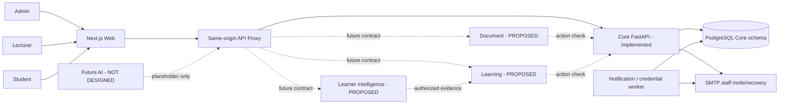
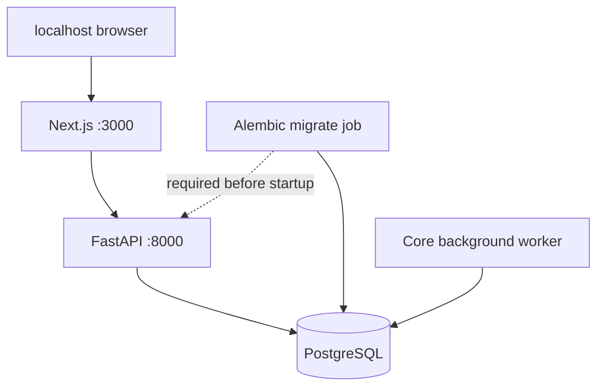

# HLD — THIẾT KẾ KIẾN TRÚC TỔNG THỂ

**Mã:** LUMI-HLD-001 · **Phiên bản:** 1.0-DRAFT · **Nguồn:** ADR-001, ARCHITECTURE.md, SYSTEM_DESIGN.md, code Core/Web tại commit 55324dc.

## 1. Mục tiêu và nguyên tắc

HLD mô tả các **view kiến trúc**: ngữ cảnh, logic, runtime, data, network/security, deployment, vận hành và hướng tiến hóa. Những phần PROPOSED không phải quyết định công nghệ được phê duyệt. Lumi triển khai trong **một monorepo** với Next.js Web và service boundaries rõ; không giả định mỗi microservice phải có máy chủ vật lý riêng.

Nguyên tắc thiết kế: một nguồn sở hữu dữ liệu, role và scope được kiểm tra tại backend, mỗi mutation quan trọng có transaction/audit, cross-service không truy cập SQL trực tiếp, event retry/idempotent, privacy by default, tài liệu sống theo phiên bản.

## 2. Context view — thành phần hiện có và tương lai

> Placeholder Future AI chỉ biểu thị vị trí sản phẩm tương lai; không mô tả thuật toán, pipeline, API, dữ liệu hoặc kết nối đã chốt.

## 3. Logical architecture — ownership

| Thành phần | Trách nhiệm hiện hành/đề xuất | Dữ liệu authoritative | Tình trạng |
|---|---|---|---|
| Web Next.js | UI theo role, routing, form, proxy, error states | Không sở hữu business records | IMPLEMENTED; E2E còn phải đối chiếu |
| Core Identity/Common | User, auth, session, role, data request, audit primitives | Core schema | IMPLEMENTED |
| Core Classroom | School, academic year, course/homeroom, roster, subject class, assignment, membership | Core schema | IMPLEMENTED |
| Core Social | Posts, comments, CORE calendar | Core schema | IMPLEMENTED |
| Core Notification | Recipient inbox, V2 outbox delivery | Core schema | IMPLEMENTED |
| Core Administration | User management, import, review, audit query | Core schema | IMPLEMENTED/một phần policy |
| Document | Source, version, class grant, notes/bookmark | DB và file storage riêng | PROPOSED |
| Learning | Practice/Assessment/Assignment, attempt/submission/grade | DB/schema riêng | PROPOSED |
| Learner Intelligence | Evidence, mastery, recommendation, report exports | DB/schema riêng | PROPOSED |

## 4. Container/runtime view

Core là **modular service**: Common/Identity/Classroom/Social/Notification/Administration trong một FastAPI deployable, cùng schema PostgreSQL `core`. Notification worker và credential delivery worker là process dùng image và dữ liệu Core; **không** phải service thứ sáu. Khi bổ sung Document/Learning/Intelligence, giữ contract và dữ liệu độc lập; không tạo FK xuyên service.

### 4.1 Request path hiện có

1. Browser gọi Web Next.js.
2. Next.js route handler nhận request `/api/v1/*`, chỉ forward operation hợp lệ qua allowlist.
3. Proxy kiểm tra origin mutation, cấu hình target và chuyển headers cần thiết.
4. FastAPI middleware/auth/permission quyết định scope/action; service module thực hiện transaction PostgreSQL.
5. Response lỗi có HTTP status và error code; Web hiển thị, không fallback mock.

### 4.2 Asynchronous Core path

1. Producer ghi nghiệp vụ + outbox V2 có `recipient_ids` snapshot trong cùng transaction.
2. Worker claim event bằng lock/skip locked, validate payload allowlist và tạo inbox dedup.
3. Thất bại retry/backoff, event thiếu dữ liệu audience V1 không được gửi theo audience hiện tại.
4. Identity credential delivery là luồng riêng; không đưa token vào notification payload.

## 5. Data architecture

- PostgreSQL 16+; schema `core`; UUID PK, timestamp timezone-aware UTC; migration Alembic 0001..0014 theo SDD mới.
- `users.school_id` FK nullable đã bổ sung ở migration 0014; mapping dữ liệu cũ **không** tự suy từ row history. Không tự chuyển sang NOT NULL khi chưa có bằng chứng sạch.
- Với service dự kiến, mỗi service sở hữu schema/credential/storage; nếu dùng một Postgres instance vẫn phải có ranh giới quyền SQL.
- Event-derived projection không thay thế authoritative data. Learning là nguồn deadline/grade; Core Calendar là projection deadline khi contract được triển khai.
- Không có thiết kế chính thức cho cache/broker/vector database của future services. **Không tự thêm công nghệ**.

## 6. Security architecture

**Trust boundaries:** Browser là vùng không đáng tin; Web proxy không thể thay server authorization; internal service caller phải được authentication; database/SMTP/worker secrets nằm server-side; export/download kiểm tra quyền tại thời điểm cấp nội dung.

**Access decision inputs:** user_id từ verified token, current status/roles, school scope, class membership/teaching assignment, class ACTIVE/ARCHIVED, action cụ thể, resource ownership, history exception. `class_id` từ URL/body chỉ là selector, không phải bằng chứng quyền.

**Defense in depth:** JWT + HttpOnly refresh cookie, CSRF/Origin, rate limit ở phạm vi triển khai hiện hành, parameter validation, CORS restricted, no-store credential response, metadata audit allowlist, TLS ở production. Không tuyên bố đã có WAF/IDS nếu chưa có bằng chứng môi trường.

## 7. Deployment views

### 7.1 Local development

- Docker Compose là môi trường phát triển/demo, không bảo đảm HA; migration phải chạy trước API startup.
- Seed dev/test có guard và database name preflight, không chạy vào dữ liệu production.
- Web live là default; `dev:mock` chỉ preview, production build từ chối mock.

### 7.2 Cloud runtime quan sát trong tài liệu 31/10

- Web: Vercel; Core API: Cloud Run; PostgreSQL: Neon; có môi trường Preview/staging và production mock.
- Production mock dùng `Lumi Mock School`; không phải production dữ liệu học sinh thực.
- Runtime có thể lệch GitHub source nếu build từ working tree chưa đồng bộ; cần image digest/source revision, cấu hình `PUBLIC_WEB_URL`, redeploy khi phù hợp.
- Không suy ra Cloud Run đã có multi-replica durability; process-local idempotency/rate-limit còn giới hạn theo Core README.

## 8. Network, failure isolation và observability

- Web→Core qua HTTPS ở public environment; Core→DB qua managed Postgres; SMTP credentials server-side.
- Readiness phải kiểm tra DB/schema có thể dùng; liveness không phụ thuộc DB; deploy rollback cần dựa trên tính tương thích migration.
- Cross-service Document/Learning/LI phải fail closed khi Core không thể xác minh quyền; hiện chưa có policy timeout/retry/chống circuit breaker được duyệt.
- Correlation ID xuyên request; audit chỉ lưu metadata cho phép; log/redaction tránh token/user input nhạy cảm.
- Event delivery ít nhất một lần là rủi ro thiết kế phải tính; consumer cần idempotency/version check; không hứa exactly-once giữa nhiều database.

## 9. Scalability và performance

- TP-01 mục tiêu: 100 concurrent users, 10 classes, 50 students/class, 20 files/class, 10 phút; Core class-list p95 backend ≤500ms (QAS-05). Mục tiêu dự án 358 CCU từng được trao đổi nhưng **không** là bằng chứng capacity hiện tại.
- Tài liệu Core-06 30/10 ghi 58.521 HTTP 200 / 58.521, backend p95 21,84ms, client loopback p95 672,04ms trong subset class-list; không suy ra full mixed service/user-facing SLA.
- Cache/idempotency/rate-limit process-local trong Core; phải thiết kế storage chung nếu chạy >1 worker/replica, không tự mở rộng.

## 10. Quyết định công nghệ theo mức độ chắc chắn

| Thành phần | Đã dùng/đã chốt | Chưa chốt, không tự áp đặt |
|---|---|---|
| Web | Next.js 15, React 19, TypeScript | UI cache chiến lược mới, CDN SLA |
| Core | Python 3.12, FastAPI, SQLAlchemy, Alembic, PostgreSQL | Cross-process rate limiter/idempotency |
| Runtime dev | Docker Compose | HA topology/auto scaling production |
| Document | Ownership & supported formats | Object storage, extraction workers, queue |
| Learning | Business process | Schema vật lý, grading engine, timer orchestration |
| Intelligence | Evidence & privacy principles | Mastery algorithm, scoring thresholds, storage |

## 11. ADR cần bổ sung/đề xuất

- ADR-002: Document storage/upload/processing/version consistency.
- ADR-003: Learning attempt state, timeout, idempotency và grade approval.
- ADR-004: Cross-service access checks và event envelope/versioning.
- ADR-005: Intelligence evidence, calibration và suppression methodology.
- ADR-006: Core multi-worker/idempotency nếu mục tiêu triển khai thay đổi.
- ADR-007: Privacy retention/executor và export governance.

Tất cả ở trạng thái **PROPOSED**, không ghi dưới dạng quyết định đã duyệt.