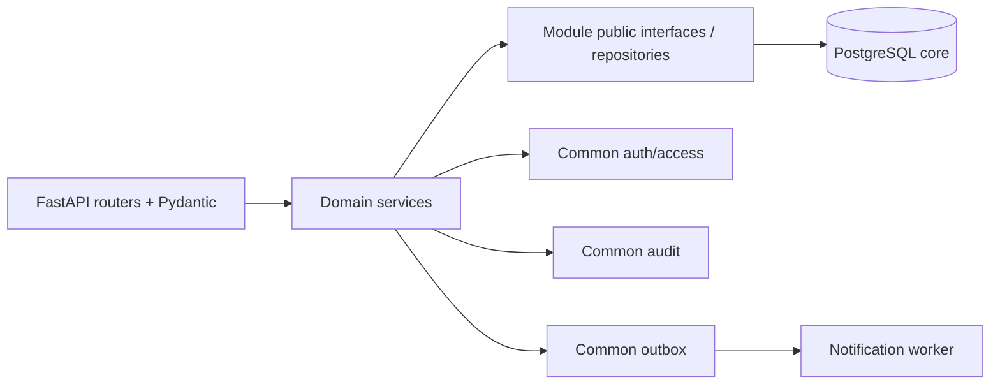
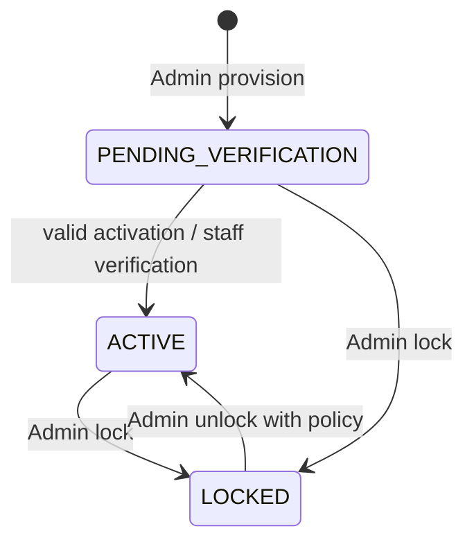
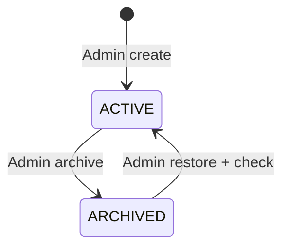

# LLD-CORE — THIẾT KẾ MODULE, DỮ LIỆU VÀ LUỒNG GIAO DỊCH

**Mã:** LUMI-LLD-CORE-001 · **Nguồn:** ORM files Identity/Classroom/Notification/Administration, Core API Contract và SYSTEM_DESIGN tại commit 55324dc. **Chú ý:** Danh mục trường bên dưới là trường kiểm tra được hoặc mức logic; Alembic 0001..0014 mới là mô tả vật lý đầy đủ.

## 1. Module và phân lớp

- **Router:** parse/validate request, dependencies, status codes, error handling.
- **Service:** nghiệp vụ, authorization theo action, transaction orchestration, version conflict, idempotency, audit/event.
- **Repository/model:** ORM trong ranh giới module; module khác gọi public DTO/helper thay vì truy cập ORM trực tiếp.
- **Common:** authentication, DB session, error envelope, audit/outbox, correlation/rate limitation.
- **Background worker:** asynchronous delivery; không chứa logic mới quyết định quyền lịch sử theo state sai.

## 2. Danh mục bảng Core đã kiểm tra trong source

| Entity/table | Trường đáng chú ý từ ORM | Vai trò | Constraint/invariant cần giữ |
|---|---|---|---|
| `core.users` | `email?`, `username?`, `school_id?`, `activated_at?`, `display_name?`, `password_hash`, `status`, `email_verified_at?`, `session_version` | Danh tính và scope | Username/email identity theo loại tài khoản, không cấp role qua body không tin cậy |
| `core.role_assignments` | `user_id`, `role` | Role kỹ thuật | Một role assignment logic; không cho phép last-admin unsafe |
| `core.auth_sessions` | `user_id`, `refresh_hash`, `family_id`, `expires_at`, `revoked_at?` | Refresh rotation/revocation | Không lưu raw refresh token |
| `core.one_time_tokens` | `user_id`, `purpose`, `token_hash`, `expires_at`, `consumed_at?` | Activation/invitation/reset | One-time, hash, correct purpose |
| `core.credential_deliveries` | `token_id`, `status`, `attempts`, `available_at`, `delivered_at?`, `last_error_code?` | SMTP reliable delivery | DB commit trước delivery; không trả token trong logs |
| `core.data_requests` | `user_id`, `request_type`, `reason?`, `status`, `resolution_note?` | Quyền dữ liệu | Policy/executor trước COMPLETED |
| `core.schools` | `name?` | Tenant/scope | School mapping không tự đoán |
| `core.academic_years` | `school_id`, `label` | Năm học | Theo trường |
| `core.semesters` | `academic_year_id`, `name` | Học kỳ | Gắn năm học |
| `core.courses` | `school_id`, `code`, `name` | Môn học | Theo trường |
| `core.homeroom_classes` | `school_id`, `academic_year_id`, `name`, `grade_level`, `roster_version` | Lớp hành chính | grade 6–12, optimistic concurrency |
| `core.homeroom_rosters` | `homeroom_class_id`, `student_id`, `joined_at`, `ended_at?` | Roster episodes | Không mất lịch sử chuyển |
| `core.subject_classes` | `school_id`, `academic_year_id`, `semester_id`, `course_id`, `homeroom_class_id?`, `name`, `grade_level`, `enrollment_mode`, `status`, `version` | Lớp môn học | ACTIVE/ARCHIVED; version guard |
| `core.teaching_assignments` | `class_id`, `lecturer_id`, `role`, `assigned_at`, `ended_at?` | PRIMARY/ASSISTING lịch sử | Một PRIMARY hiện hành theo policy |
| `core.class_memberships` | `class_id`, `student_id`, `source`, `status`, `joined_at`, `ended_at?` | Membership episode | Một ACTIVE episode/class/student; retention lịch sử |
| `core.notifications` | `recipient_id`, `type`, `payload_json`, `dedup_key`, `sequence`, `read_at?`, `created_at` | Inbox | Recipient-only, dedup, watermark |
| `core.student_import_batches` | `school_id`, `actor_id`, `status`, `rows_json`, `checks_json`, `results_json`, `homeroom_id?`, `roster_version?`, `expires_at` | Import preview/confirm | Preview TTL, deterministic reconciliation |

**Bảng khác cần đối chiếu Alembic/ORM tại chính revision triển khai:** post/comment, calendar events, outbox events, audit events. Các tên trong sơ đồ logic là minh họa và không tự khẳng định trường vật lý chưa đọc.

## 3. Identity state machine

- Login sử dụng username Student hoặc email Staff, không cho Student self-register.
- Activation chỉ PENDING, đúng purpose/hạn, consumed một lần; cấp lại làm mã cũ vô hiệu.
- LOCKED chặn login/refresh/khôi phục trái chính sách, không đồng nghĩa xóa dữ liệu.
- Session version và refresh family hỗ trợ revoke; password change/role change/status change phải cập nhật hiệu lực ngay trong các access checks.
- SMTP delivery có trạng thái retry và reissue, không tự “rollback email” sau khi mail đã gửi.

## 4. Classroom state machine và transaction

### 4.1 Subject class

### 4.2 Membership episode

```mermaid
stateDiagram-v2
  [*] --> ACTIVE: Admin/AUTO enrollment
  ACTIVE --> ENDED: Admin transfer/end/roster sync
  ENDED --> ACTIVE: New episode; old episode preserved
```

### 4.3 AUTO sync transaction (**thiết kế đã triển khai theo contract**)

1. Xác minh Admin và School hiện hành; class/homeroom thuộc cùng scope, mode AUTO.
2. Nhận expected class/roster version từ preview; lock và recheck để tránh TOCTOU.
3. Tính tập add/end; insert new episode/end current episode; không đụng lớp MANUAL.
4. Tăng version, ghi audit và outbox event có recipient snapshot trong cùng transaction.
5. Commit → response; nếu conflict 409, rollback toàn bộ, caller preview lại.

### 4.4 Transfer và archived

- Transfer hành chính cập nhật hai roster/Auto enrollments theo quy tắc cùng năm/khối; tránh deadlock bằng thứ tự lock ổn định do code triển khai quyết định.
- Transfer manual class kiểm tra môn/năm/học kỳ phù hợp, kết thúc source episode và tạo destination episode.
- Archive không xóa class/posts/membership; chặn mutations mới, cho phép đọc theo policy; restore không hồi sinh permission lịch sử của user đã mất quyền.

## 5. Social, calendar và notification design

- Feed/comments: soft delete; author DTO không lộ login identifier; moderation quan trọng audit.
- Calendar: event `CORE` chỉnh sửa được theo quyền; deadline `LEARNING` sau này chỉ read-only projection. Timezone lưu UTC; client hiển thị local.
- Notification: outbox version 2 chứa recipient snapshot ID/school/class/aggregate metadata, **không chứa raw post body/chat/token**. Consumer dedup theo khóa ngữ nghĩa; `read-all` có watermark để không mark thông báo xuất hiện sau thao tác là đã đọc.
- Legacy V1: giữ lại/quarantine, không gửi cho current audience.

## 6. Audit và logging

- `audit_events` có school-at-event-time; legacy null scope không tự bổ sung từ actor hiện tại.
- Admin audit filter theo school + pagination/cursor; metadata allowlist; reason code chuẩn hóa.
- Nội dung audit tối thiểu: correlation ID, actor, action, target type/id, scope/time, changed-fields allowlist; không log secrets/raw chat.
- Transaction thất bại không phát audit “thành công” cho mutation chưa commit.

## 7. API layer, cross-module và repository invariants

| Boundary | Quy tắc |
|---|---|
| Router → Service | DTO Pydantic/typed, không tạo ORM trực tiếp từ JSON |
| Administration → Identity | Gọi `identity.public.*`, truyền actor/correlation/session đúng contract |
| Social → Classroom/Identity | Permission/action và user summary qua public interface, không đọc bảng trực tiếp |
| Notification → producers | Event allowlist, audience snapshot lấy trong producer transaction |
| Worker → PostgreSQL | Lock, dedup, retry/backoff; không gửi nhầm V1 |
| Internal class access endpoint | Service credential + action check; không nhận một class_id như quyền |

## 8. Concurrency, idempotency và các giới hạn thực tế

- UUID Idempotency-Key theo contract; response cache của một số operations vẫn process-local và mất khi restart, không nhân đôi kết quả import confirm bền vững.
- Last-admin concurrency dùng transaction/advisory locking và rule kiểm tra Admin ACTIVE khác.
- Optimistic version `expected_revision`, `expected_roster_version`, `expected_class_version` chặn stale write.
- Process-local limiter không chứng minh multi-replica; muốn scale phải có ADR/storage chung/test mới.
- Secrets/cookie: Secure+HttpOnly ở production HTTPS, local HTTP phải cấu hình phù hợp; Origin/CSRF không được vô hiệu hóa vì E2E.

## 9. Migration và bảo trì schema

- Các revision đã chạy là lịch sử bất biến. Migration 0014 thêm nullable FK `users.school_id` tới School, không backfill bằng suy đoán.
- `alembic upgrade head` + `alembic check`, report/plan/apply mapping theo manifest và plan digest; không chạy tự động trên dữ liệu thật.
- Seed dev/test chỉ với DB clean, tên phù hợp guard, credentials ngẫu nhiên/qua environment; không reset DB chưa xác minh.
- Phục hồi cần backup/snapshot và rollback runbook; downgrade không mặc nhiên an toàn khi đã có dữ liệu mới.

## 10. Đầu vào/đầu ra quan trọng để agent triển khai

- Bắt đầu từ một FR-ID và đúng Rule ID, không tự thêm field/route ngoài OpenAPI.
- Tạo regression test negative permissions + state/version conflict + DB transaction.
- Khi API đổi, cập nhật tests/contract snapshot, FRS UI, RTM và PR note.
- Để kiểm chứng frontend, chạy browser trên live adapter và PostgreSQL test sạch, lưu bản revision/seed manifest/evidence.