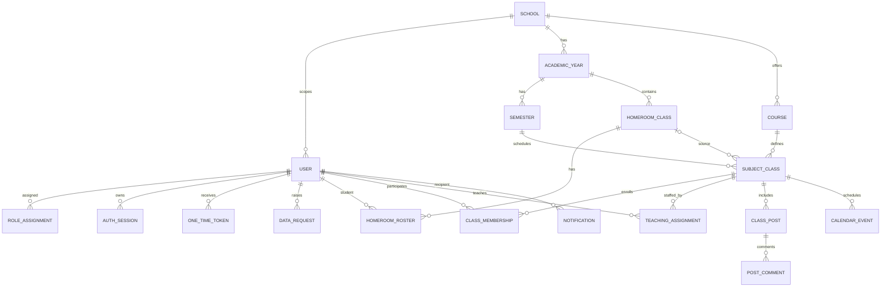
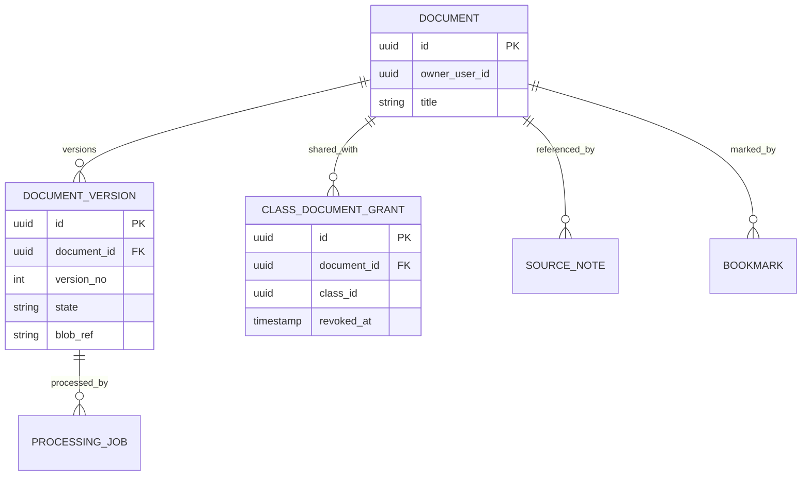
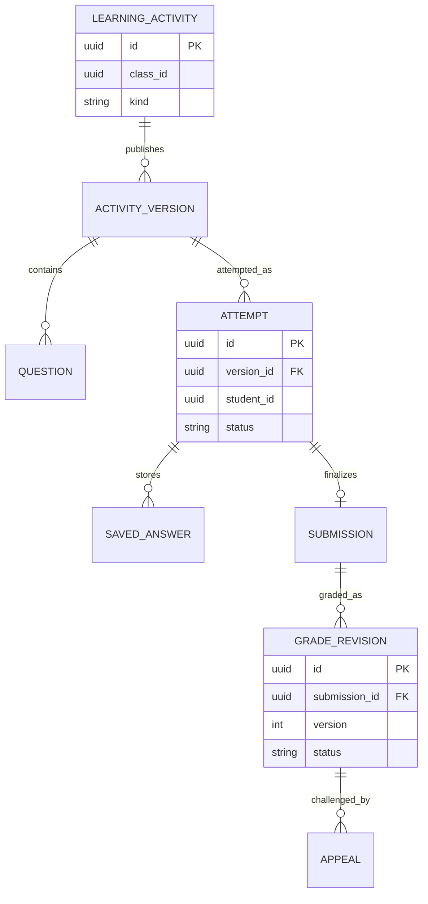
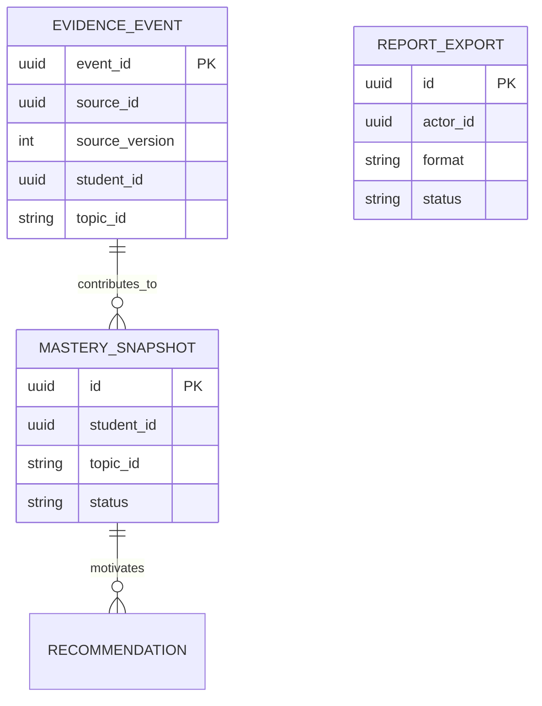
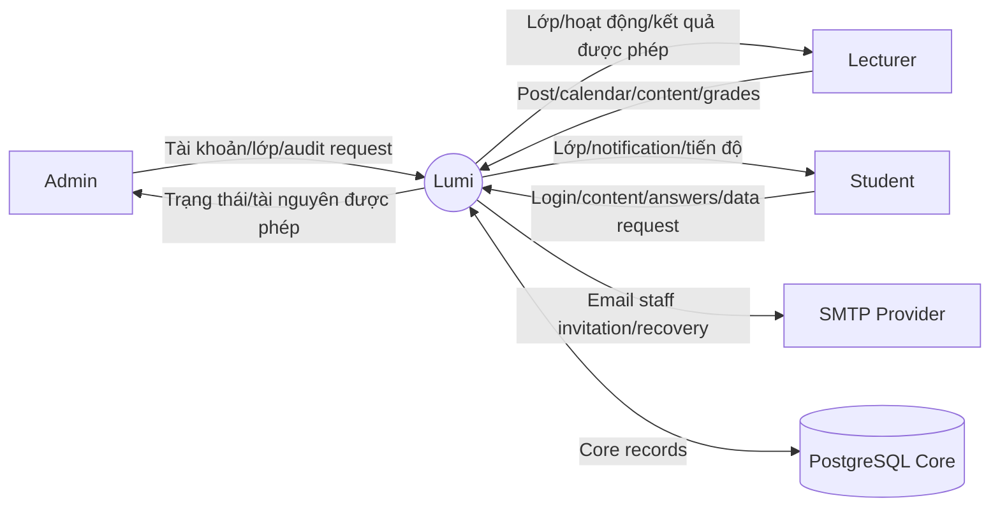
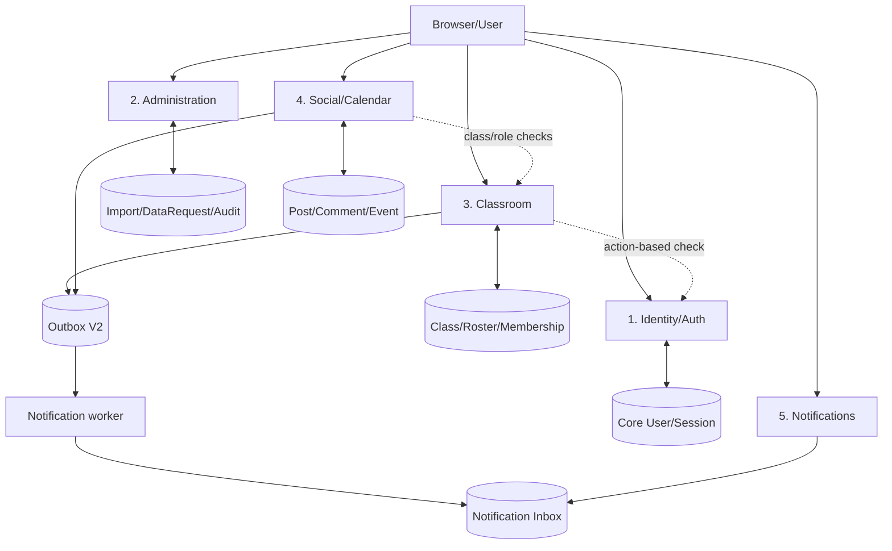
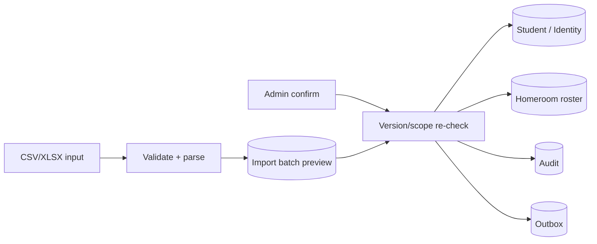
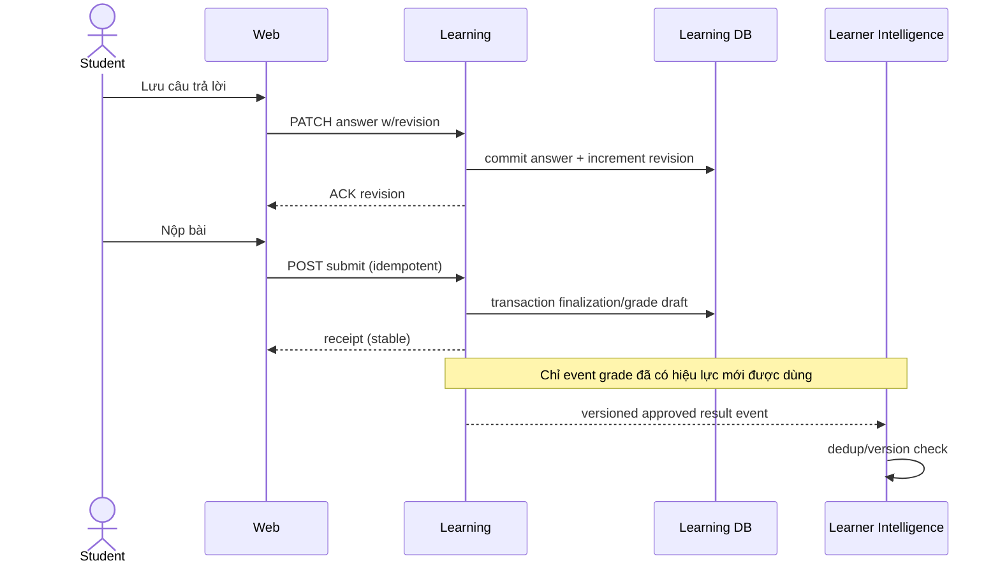

# SƠ ĐỒ DỮ LIỆU — ERD, DFD, SEQUENCE VÀ STATE

**Mã:** LUMI-MODEL-001 · **Phiên bản:** 1.0-DRAFT · **Trạng thái:** Core ERD dựa trên ORM và SDD; future ERD chỉ là logical proposal.

## 1. ERD Core — mức logic kiểm chứng được



> Đây là ERD **logical**: không hiển thị đầy đủ FK/index/constraint, nullable và cột audit. Tên bảng vật lý có thể khác nhãn diagram; ví dụ ORM dùng `homeroom_classes`, `homeroom_rosters`, `subject_classes`, `class_memberships`.

## 2. Candidate ERD Document — PROPOSED



Core class_id/user_id chỉ là external identifiers; **không có FK trực tiếp sang DB Core**.

## 3. Candidate ERD Learning — PROPOSED



Không lấy mô hình này làm migration khi chưa quyết định Practice/Assessment/Assignment có bảng riêng hay chung.

## 4. Candidate ERD Learner Intelligence — PROPOSED



Nguồn evidence là Learning qua contract, không join SQL trực tiếp.

## 5. DFD Level 0 — ranh giới Lumi



**Data trust:** Browser chỉ là requester, không quyết định School scope hoặc access control.

## 6. DFD Level 1 — Core đang triển khai



**Không mô tả thành 5 microservices Core**: 5 ô trên là module trong một FastAPI service, dùng chung transaction/schema theo boundary đã triển khai.

## 7. DFD Level 2 — Student import/roster



- Không lưu raw file/formula vào client-visible response nếu không cần.
- Transaction commit nhất quán; replay dùng kết quả import batch bền vững.

## 8. Sequence — revoke và historical access (future Document)

```mermaid
sequenceDiagram
 actor U as Học sinh
 participant W as Web
 participant D as Document
 participant C as Core access-check
 participant DB as Document grant
 U->>W: Mở tài liệu
 W->>D: GET source request
 D->>C: check action current
 C-->>D: allowed/denied
 D->>DB: check active grant
 DB-->>D: active/revoked
 alt both allowed
 D-->>W: content/secure link
 else denied/revoked/dependency failure
 D-->>W: Deny; do not reveal source
 end
```

## 9. Sequence — save/submit và grade event (future Learning)



## 10. Danh sách sơ đồ cần cập nhật khi triển khai

| Sơ đồ | Hiện trạng | Điều kiện cập nhật |
|---|---|---|
| Core ERD physical | Logical snapshot này; migration là chuẩn | Sau mỗi migration/ORM change |
| Document logical/physical | PROPOSED | Sau ADR storage/schema/API |
| Learning attempt/grade | PROPOSED | Sau quyết định version/transfer/approval |
| Intelligence evidence | PROPOSED | Sau model/evaluation contract |
| AI | **OUT OF SCOPE** | Không vẽ trong giai đoạn này |