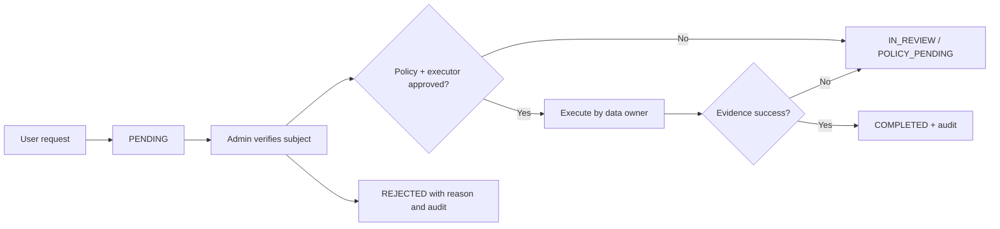

# SECURITY, PRIVACY & DATA GOVERNANCE DESIGN

**Mã:** LUMI-SEC-001 · **Trạng thái:** Chính sách từ Business Rules; biện pháp Core theo code/tài liệu; control future là PROPOSED.

## 1. Tài sản và đối tượng rủi ro

| Asset | Mức nhạy cảm | Nguy cơ chính |
|---|---|---|
| Password hash, refresh/token hash, activation/invitation | Rất cao | Chiếm tài khoản, replay, lộ credential |
| Student roster, school/class membership | Cao | Truy cập sai trường/lớp, leak danh tính |
| Post/comments/calendar | Nội bộ lớp | IDOR, XSS, lộ dữ liệu cũ |
| Private source notes, documents/grants | Cao | Revoked source vẫn được mở, quote leakage |
| Attempts/submissions/grades/appeals | Rất cao | Sửa/duyệt điểm trái phép, duplicate grade |
| Learning evidence/reports | Cao | Kết luận sai, tái định danh qua aggregate |
| Audit/events/backups | Cao | Lưu raw secrets, retention tùy tiện |

## 2. Threat model theo STRIDE rút gọn

| Threat | Attack vector | Defense/verification |
|---|---|---|
| Spoofing | Token đánh cắp/replay, tự đặt header user_id | Server-signed JWT/session rotation/revocation, service-auth nội bộ |
| Tampering | Đổi class_id, role, version, grade | Action-based access, server field allowlist, version check, audit |
| Repudiation | Admin chỉnh roster/grade không log | Transactional audit + actor/scope/correlation ID |
| Information disclosure | Cross-class API IDOR, stale grant, log token | 404 conceal, permission recheck, redaction, secrets no-store |
| Denial of service | Login brute force, upload/parser bomb, retry flood | Rate limit, size/ZIP guard, job lease/quota (future) |
| Elevation of privilege | ASSISTING tự duyệt, cuối Admin bị gỡ | Per-action policy, PRIMARY approval, last-admin locks |

## 3. Authentication/session controls

- Student username do Admin cấp; staff email; public self-register bị 403.
- Mã kích hoạt/reset một lần, hash, purpose và expiry. Không đặt code vào logs/query string.
- Refresh cookie HttpOnly/Secure/SameSite khi production HTTPS; CSRF/Origin checks áp dụng cho refresh/logout.
- Khi role/status/password/session_version thay đổi, token cũ phải bị thu hồi hiệu lực theo contract; locked chặn truy cập.
- Rate limiting/idempotency hiện chỉ process-local; không chứng nhận bảo vệ khi multi-replica.
- SMTP staff delivery tách notification; retry/reissue có audit, email có thể duplicate khi failure race.

## 4. Authorization: không dùng RBAC đơn thuần

**Điều kiện quyết định một action:** verified user → ACTIVE? → role hiện hành → school scope → class/resource scope → class status → assignment/membership hiện hành → ownership → exception lịch sử (nếu có). Mọi phép kiểm tra trả `deny` khi missing/unavailable authority.

| Kiểm soát | Trường hợp negative phải test |
|---|---|
| User school scope | Staff trường A chọn class/user trường B |
| Current membership | Student kết thúc enrollment thử POST post lớp cũ |
| Class lifecycle | Lecturer tạo calendar/post trong archived class |
| Teacher assignment | ASSISTING cố đổi PRIMARY hoặc roster |
| User state | LOCKED user dùng access token chưa hết hạn |
| Resource ownership | User sửa note/document source của người khác |
| Historical access | Ex-student đọc grades đã nộp nhưng không đọc feed mới |
| Credential/internal | Browser gọi trực tiếp internal check không có service credential |

## 5. Secure API và frontend

- API validate trường và dùng parameterized ORM; không tin input user_id/school_id.
- Next.js same-origin proxy có allowlist route/headers/query, chặn unsafe Origin mutation, không ghi token sang analytics.
- XSS: escape/sanitize body post/comments, HTML preview của tài liệu cần sandbox/allowlist khi implement.
- SSRF/path traversal: future Document upload/download phải validate storage keys/URLs; không nhận arbitrary fetch URL chưa có policy.
- CORS chỉ public origin được xác định, không bật wildcard + credentials.
- Redact sensitive error details; structured error code cố định không tiết lộ hidden record.

## 6. Bảo vệ dữ liệu học sinh và riêng tư

- Một school trong MVP nhưng school boundary ở backend; không có super-admin nhiều trường.
- Admin/teacher không có quyền mặc định đọc chat riêng tư trong Business Rules; AI đang ngoài phạm vi tài liệu.
- Notes của học sinh owner-only; khi Document source revoke thì self text còn, quote/source bị che.
- Assessment official grade chỉ role/approval đúng, có audit và grade history.
- Không tự định thời hạn pháp lý hoặc suy ra đại diện hợp lệ; cần operator approve trước vận hành dữ liệu thật.

## 7. Data-request governance

- `identity_verified` là ghi nhận xác minh thủ công, không tự chứng minh danh tính.
- ACCESS/EXPORT/CORRECTION có workflow thủ công đã duyệt trong Core hiện tại; DELETE/retention liên service vẫn deferred.
- Không để việc xóa User cascade làm chính sách xóa toàn hệ thống; giữ audit tối thiểu theo policy.
- Mỗi data type cần: owner service, retention, lý do giữ, masking/anonymization, executor, backup effects, verify/audit.

## 8. Retention decision matrix — chưa gán thời hạn

| Loại dữ liệu | Owner | Tác động khi user yêu cầu DELETE | Retention duration |
|---|---|---|---|
| User/profile/auth | Core.Identity | Điều tra điều kiện xóa/ẩn danh và chứng cứ liên quan | **PENDING POLICY** |
| Classroom episodes/audit | Core.Classroom/Common | Bảo vệ lịch sử nghiệp vụ và giới hạn truy cập | **PENDING POLICY** |
| Feed/Comments | Core.Social | Xóa/ẩn nội dung theo rule L1; audit cần thiết giữ theo policy | **PENDING POLICY** |
| Documents/notes | Document | Tách self-written text khỏi revoked quote/source | **PENDING POLICY** |
| Attempts/grades | Learning | Không xóa bừa điểm/hồ sơ phải lưu theo chính sách | **PENDING POLICY** |
| Evidence/reports | Intelligence | Recompute/anonymize versioned aggregates | **PENDING POLICY** |
| Logs/backups | Operator | Bản sao và audit preservation cần cơ chế riêng | **PENDING POLICY** |

## 9. Audit và reporting controls

- Audit event quan trọng gồm actor, action, target, school-at-event-time, timestamp, correlation ID và reason code allowlist.
- Không ghi password, token, raw private chat, full documents, arbitrary reason text.
- Report export yêu cầu permission ở create **và** download; xử lý filtering/suppression server-side, chống truy cập file URL sau revoke.
- Tài liệu public không đưa địa chỉ production credentials/keys; test dùng synthetic data và secret store.

## 10. Security test acceptance

SEC-T01..: login/refresh replay; LOCKED access; cross-school IDOR; non-admin Admin route; ASSISTING cannot approve; stale grant; replay event; XSS; CSRF; sample report export leakage; private notes; secret-free audit and notification. Mỗi finding cần CVSS/impact hoặc mức rủi ro, reproduction an toàn, fix/test/owner.

## 11. Những kiểm soát bắt buộc trước production thật

1. Đánh giá cơ sở xử lý dữ liệu học sinh, đại diện/xác minh khi cần và retention từng loại.
2. Policy/executor DELETE/EXPORT across services và backup runbook.
3. Secret management, SMTP provider configuration, TLS và rotation.
4. Threat modeling Doc upload, Learning grade approval, Intelligence aggregation.
5. Log redaction, backup restore drill, incident notification và access review.

Không tuyên bố tuân thủ pháp luật cụ thể nếu chưa qua đánh giá pháp lý phù hợp.