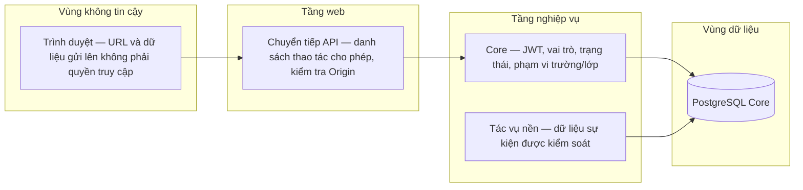
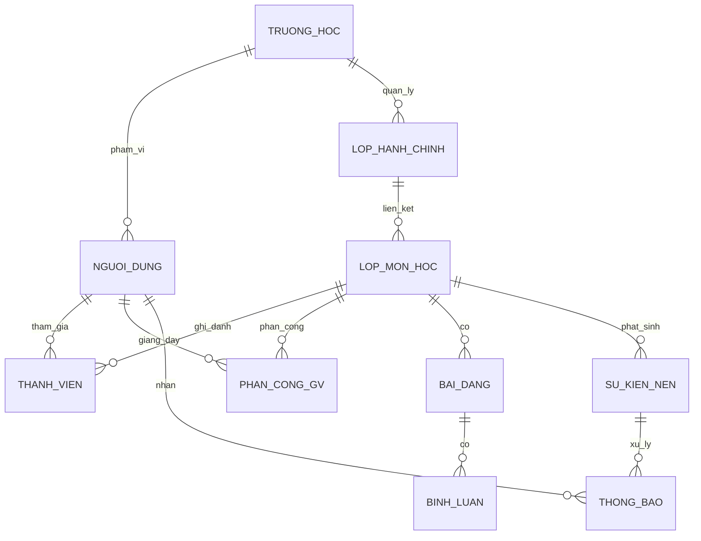
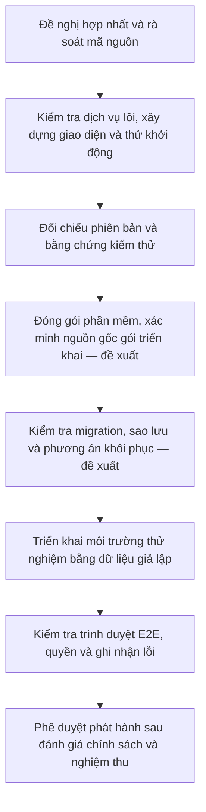
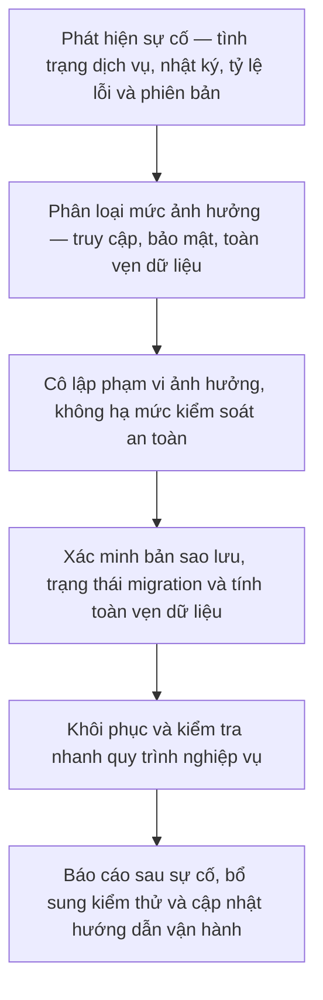

# PHẦN D — AN TOÀN HỆ THỐNG, VẬN HÀNH VÀ CÁC QUYẾT ĐỊNH KIẾN TRÚC

**Mã:** LUMI-ARC-QA-002 · **Trạng thái:** thiết kế đối chiếu code + phần chưa duyệt ghi rõ `PENDING/PROPOSED`.

## D1. Những yêu cầu chi phối lựa chọn kiến trúc

| Yếu tố chi phối | Căn cứ | Phương án thiết kế | Bằng chứng và nội dung còn thiếu |
|---|---|---|---|
| Lớp chính khóa một trường 6–12 | Business Rules A1–A8 | School scope, homeroom, AUTO/MANUAL, Admin-only | Core code/contracts; legacy mapping policy riêng |
| Quyền hiện hành thay quyền lịch sử | H/L/M/O | Phía máy chủ access decisions, 404 concealment, history exception | Core tests; future Learning/Document còn thiếu |
| Kiểm soát tài khoản học sinh | F1/K | Admin provision + mã kích hoạt single-use | Core Identity; verify real onboarding policy trước dữ liệu thật |
| Toàn vẹn roster | A4/A5, QAS-03 liên quan | Transaction, version conflict, unique ACTIVE constraint | Core tests; cross-service attempts chưa triển khai |
| Thông báo đúng audience lịch sử | G4/Notification | V2 recipient snapshot, worker dedup | Implemented; V1 backlog bị giữ lại để tránh gửi nhầm |
| Dữ liệu nhạy cảm và khả năng giải trình | F4/F7/K1–K6 | Audit allowlist, scoped data request, retention pending | ACCESS/EXPORT/CORRECTION thủ công; DELETE deferred |
| Demo ba ngày/increment | Ràng buộc project | Compose, CI, seed giả lập, browser smoke | Không thay thế full acceptance |
| Khả năng mở rộng | QAS TP-01 | Class-list load harness + middleware connection control | Chưa full mixed workloads, multiworker cache process-local |
| Cách ly service tương lai | ADR-001 | DB ownership, API service access check | Document/Learning/LI chưa có phía máy chủ live |

## D2. Mô hình nguy cơ theo các điểm truy cập hệ thống

**A09 - Ranh giới bảo mật**

[Nguồn sơ đồ](diagrams_arch/A09_Trust_Boundaries.mmd)

| ID | Bề mặt tấn công / loại rủi ro | Ví dụ thao tác | Bảo vệ phải kiểm tra | Test evidence cần có |
|---|---|---|---|---|
| SEC-01 | Spoofing | Tự ghi `school_id` hoặc `role=ADMIN` vào body | Claim JWT kiểm tra lại DB/status hiện hành | 401/403/404 matrix |
| SEC-02 | Tampering | Sửa class ID để xóa comment của người khác | Ownership + classroom action scope | HTTP negative tests |
| SEC-03 | Repudiation | Admin thay roster xong không có ai chịu trách nhiệm | Audit/actor/action/correlation, reason code | Audit unit/integration |
| SEC-04 | Information disclosure | Truy cập `/admin/users` trường khác | School filtering, no-secret DTO | Cross-school leakage tests |
| SEC-05 | Denial-of-service | Spam login/forgot/import | Rate limits, validation, pool admission | Limiter tests; load baseline |
| SEC-06 | Elevation of privilege | ASSISTING tự archive hoặc gỡ PRIMARY | Admin-only; version/role | 403/404 + state invariant |
| SEC-07 | Browser/proxy request forgery | POST khác Origin, refresh CSRF | Exact Origin, cookie flags, Core protections | Browser + HTTP tests |
| SEC-08 | Notification recipient contamination | Event V1 phát nhầm Student mới tham gia | V2 snapshot + V1 quarantine | Worker replay tests |
| SEC-09 | Credential leakage | Token recovery trong inbox/audit/log | One-time hash + separate SMTP delivery | Redaction/security review |
| SEC-10 | Persistence drift | App code mới chạy trên schema cũ | Migrate job before API + `alembic check` | CI Compose smoke |

### D2.1. Phân quyền không chỉ là RBAC

**RBAC** cho ba global roles là cần nhưng chưa đủ. Quyết định quyền hợp lệ phụ thuộc trạng thái account, school scope, class status, membership, teaching assignment, ownership và `action`. Vì vậy mô hình thực tế là **RBAC kết hợp kiểm tra ngữ cảnh/tài nguyên**. Ví dụ: giảng viên A có `LECTURER` nhưng không được xem lớp B nếu không được phân công; học sinh đã chuyển lớp có thể giữ quyền xem lịch sử cá nhân được phép, không thể tiếp tục xem post mới của lớp cũ. Phía máy chủ làm authority; UI chỉ phản ánh.

### D2.2. Đường truyền và bí mật

- HTTPS bắt buộc cho Web public và URL mời staff; local HTTP ngoại lệ với `COOKIE_SECURE=false` được bật rõ.
- `SECRET_KEY`, `INTERNAL_SERVICE_SECRET`, `DATABASE_URL`, SMTP credentials là server-side; không đưa vào `NEXT_PUBLIC_*`, browser bundle hoặc screenshots.
- Một token làm mới HttpOnly không phải access JWT; luồng rotate/CSRF/Origin phải kiểm thử ở cả proxy và phía máy chủ.
- Số liệu logs/audit không chứa password, activation/recovery token, raw chat hoặc nội dung riêng tư học sinh.

## D3. Quản trị dữ liệu và bảo đảm tính nhất quán

**A12 - Core data domains**

[Nguồn sơ đồ](diagrams_arch/A12_Core_Data_Domains.mmd)

### D3.1. Ranh giới owner và transaction

- **Core / Identity** giữ Account, Role, Token, Session, credential delivery, data request intake.
- **Core / Classroom** giữ School, AcademicYear, Homeroom/Roster, Course, SubjectClass, TeachingAssignment/Membership.
- **Core / Social** giữ Feed/Comments/CORE Calendar.
- **Core / Notification** ghi inbox; dùng transactional outbox từ Core transaction.
- **Future Document** sở hữu tài liệu nguồn, phiên bản, grant, notes/bookmarks; không được chặn logic Core bằng SQL cross-service.
- **Future Learning** sở hữu bài luyện tập/chính thức, điểm và phiếu phúc khảo; policy transfer attempts chưa chốt, không “lấy chung bảng” trong Core.
- **Future LI** sở hữu evidence/mastery/recommendation; chỉ kết luận có evidence và privacy threshold khi được duyệt.

### D3.2. Trạng thái dữ liệu và cập nhật đồng thời

- `expected_class_version` hoặc roster version là optimistic concurrency: khi phiên bản client cũ, trả 409 để đọc lại dữ liệu và xác nhận, không tự ghi đè.
- Import preview/confirm cần tính nhất quán và replay bền vững; không gửi cùng tệp lần hai để “sửa” kết quả bất kỳ khi không rõ transaction trước đã commit.
- Outbox event và business mutation phải cùng transaction DB. Worker ở vùng eventual consistency; notification đến muộn không được tự tạo quyền truy cập nội dung đã bị revoke.
- Các schema migration đã áp dụng là immutable. Migration `0014` thêm nullable FK `users.school_id` với quá trình validate an toàn; không backfill arbitrary mapping.

## D4. Phân tích lợi ích và đánh đổi của các quyết định kiến trúc

| Quyết định | Lợi ích | Đánh đổi / nguy cơ | Dấu hiệu cần thiết kế lại |
|---|---|---|---|
| Core modular deployable duy nhất | Triển khai nhanh, transaction chung, thuận tiện nhóm 4 người | Tài nguyên/nhịp deploy trong Core bị gắn nhau | Nhu cầu scale hoặc deploy các module Core độc lập có bằng chứng |
| Same-origin Next.js proxy | Giảm cross-origin browser complexity, allowlist | Thêm một hop và chi phí proxy | Proxy bottleneck hoặc cần api gateway chuyên dụng |
| PostgreSQL Core schema | Transaction + constraints rõ, dễ test | DB connection pool / lock contention, mối liên kết trong Core | Nhiều writer/scale rõ ràng và metric bottleneck |
| Transactional outbox | Không mất event khi commit nghiệp vụ | Delivery async eventual consistency, duplication/retry | Lag cao, throughput/delivery SLAs cần broker |
| Process-local idempotency/rate limit | Đơn giản trong single-worker | Restart/multi-replica không bảo đảm state | Mở nhiều Core replica, yêu cầu replay bền vững qua restart |
| Admin-only provisioning | Quản trị học sinh dễ kiểm soát hơn self-join | Đòi hỏi quy trình operator/school roster chính xác | Nhiều trường hoặc self-service được Business Rules phê duyệt |
| Synthetic Production Mock | Test deploy tránh dữ liệu học sinh thật | Không đại diện privacy/compliance mô hình tải thật | Trước phát hành dữ liệu thật phải có policy/consent/retention |

**Không kết luận** microservices tự động tốt hơn monolith; kiến trúc Lumi có năm service mục tiêu, nhưng ở hiện tại mới Core deployable chứa các module trên. Chi phí điều hành, consistency, observability và giới hạn nhóm phải được phản ánh trong ADR.

## D5. Theo dõi tình trạng vận hành và mục tiêu chất lượng dịch vụ

| Thành phần | Metric/Signal cần đo | Ngưỡng đã có? | Ghi chú |
|---|---|---|---|
| Core API | Request count, 4xx/5xx, phía máy chủ p95/p99, correlation | QAS class list p95 ≤ 500ms | Không nhầm phía máy chủ p95 với ở phía người dùng |
| PostgreSQL | Pool active/wait, query p95, locks, migration head, disk | Chưa có alert production approved | Ghi CPU/RAM/DB version thực |
| Worker | Outbox age, pending/retry, poison/quarantine, inbox delivered | Chưa có worker SLO approved | Không log event payload nhạy cảm |
| Credential delivery | Pending/reissue/expired, SMTP failure | Retry flow đã có; alert TBD | Email duplicate có thể xảy ra khi provider ACK mất |
| Web | Browser API failures, route crashes, response timings | Chưa có RUM target approved | Không thu raw student inputs |
| Audit/privacy | Admin intervention counts, unusual denies, request status | Retention/executor DELETE pending | Không gửi bản sao PII sang log aggregator |

### D5.1. Health, readiness và khôi phục phiên bản trước

- `/health/live`: 200 khi process còn sống, không phụ thuộc DB.
- `/health/ready`: xác minh database khả dụng và schema core phù hợp; DB outage cho 503 trong Compose smoke.
- Mỗi deploy cần `source SHA = CI SHA = image digest provenance = runtime revision`, đối chiếu schema head.
- Khôi phục phiên bản trước code chỉ an toàn khi DB schema tương thích phiên bản cũ; không tự chạy downgrade. Nếu không tương thích, thực hiện runbook restore/forward-fix đã review.

## D6. Quy trình phát hành và ứng phó sự cố

**A13 - Quy trình phát hành và kiểm chứng**

[Nguồn sơ đồ](diagrams_arch/A13_Release_Pipeline.mmd)

**A16 - Xử lý và khôi phục sau sự cố**

[Nguồn sơ đồ](diagrams_arch/A16_Incident_Recovery.mmd)

**Phân biệt CI hiện hành và điều kiện chấp thuận phát hành đề xuất:** `core-ci.yml` có core-tests, web-build, compose-smoke và core-load manual. Các bước image provenance, staging sign-off, rollout phê duyệt production, chính sách RPO/RTO và backup restore rehearsal trong A13 là **PROPOSED**; không được tự nhận là pipeline hiện nay đã triển khai đủ.

### D6.1. Bảng phản ứng sự cố

| Sự cố | Phạm vi | Thao tác an toàn đầu tiên | Không được làm | Điều kiện khôi phục |
|---|---|---|---|---|
| DB không sẵn sàng | Core API, worker, Web live business ops | Kiểm tra ready/log/DB connection, scale/restore theo runbook | Seed/downgrade/reset volume vô kiểm soát | Ready 200, schema đúng, smoke auth/data |
| Notification backlog lớn | Inbox có thể trễ | Kiểm tra pending age, event version, retry reason | Rebuild recipients V1 bằng audience hiện tại | Đúng recipient, dedup, replay safety |
| Email invitation lỗi | Staff onboarding/recovery | Kiểm tra delivery row/SMTP TLS/config | In token vào log, gửi mã Student bằng email | Reissue/retry đúng policy, recipient nhận được |
| Cross-school exposure | Dữ liệu học sinh | Chặn đường lộ, bảo toàn audit evidence, revoke session nếu cần | Xóa logs chứng cứ, tự sửa user school scope | Regression/incident review, privacy response |
| Release runtime lệch main | Bất kỳ module | So sánh image digest/commit/deploy config | Deploy nóng không biết DB schema | Image đúng, khôi phục phiên bản trước plan, CI pass |
| Data request DELETE | Privacy/compliance | Giữ IN_REVIEW, chuyển operator review policy | Bấm COMPLETED giả hoặc cascade xóa hàng loạt | Executor/policy được duyệt và audit xác nhận |

### D6.2. Backup và DR: những gì phải có trong một hồ sơ chính thức

- Inventory: databases, file storage tương lai, encryption keys, secrets, config, audit, worker/outbox, exported reports.
- Backup schedule, encryption, retention và vùng lưu trữ thứ cấp: **PENDING OPERATOR POLICY**, không tự đặt.
- RPO/RTO: **chưa có target được phê duyệt** trong nguồn Lumi; không ghi con số không đo.
- Restore drill: chuẩn bị DB giả lập, restore sang environment cô lập, chạy `alembic check`, verify users/sessions/roster/outbox, test privileged access, ghi actual elapsed time.
- Với future Learning/Document, phải kiểm tra lại grants, submissions, grade version, source file checksums trước khi phát hành, không chỉ restore DB thành công.

## D7. ADR backlog cần viết khi ra quyết định thật

| ADR ID đề xuất | Quyết định cần chốt | Bên phê duyệt | Có phải Core MVP blocker? |
|---|---|---|---|
| ADR-CORE-SCALE | Single-worker vs replicas, shared rate/idempotency store | Architect/Operator | Không, nếu giữ single worker |
| ADR-PRIVACY-RETENTION | Retention theo data type + DELETE executor | Product/Operator/Privacy reviewer | Có trước dữ liệu người thật |
| ADR-CLOUD-RELEASE | Pipeline source-image-runtime, TLS/secret, khôi phục phiên bản trước | Architect/Ops | Có trước release production thật |
| ADR-DOC-STORE | Object storage, scanning, extraction, version/grant | Future Document owner | Chỉ G3 |
| ADR-LEARNING-ATTEMPT | Timer, save/resume, immutable attempt, grade approval | Future Learning owner + Product | Chỉ G4 |
| ADR-LI-EVIDENCE | Evidence provenance, correction version, suppression | Future LI owner + Product | Chỉ G5 |

Không tự thiết kế AI Service hoặc đặt ADR về model/retrieval vì người dùng yêu cầu hoãn phần đó.