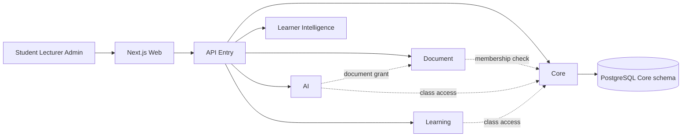

# Kiến trúc Microservices v1

**Trạng thái:** BASELINE THIẾT KẾ · **Ngày:** 2026-10-11

## 1. Cấu trúc và stack
**Một Monorepo**, năm Microservices. Next.js Web gọi các API có phiên bản. Core chạy FastAPI, PostgreSQL (SQLAlchemy/Alembic), Docker Compose. Mỗi service có image, API, dữ liệu và quy trình triển khai riêng; không có yêu cầu máy chủ vật lý riêng.

## 2. Ownership
| Service | Sở hữu dữ liệu |
|---|---|
| Core | User, Role, Session, Course, Class, Membership, JoinRequest, Feed, Comment, Calendar, Notification, Core audit/admin |
| Document | Library, File, DocumentVersion, ClassDocumentGrant, notes/bookmarks gắn nguồn |
| Learning | Practice, Assessment, Assignment, Attempt, Submission, Grade, deadline chính thức |
| AI | Conversation, Message, RAG index/retrieval metadata dẫn xuất |
| Learner Intelligence | Evidence, MasterySnapshot, Recommendation |

**Deadline:** Learning là nguồn chính thức, Core Calendar chỉ hiển thị bản chiếu; thay đổi deadline phải thông báo (L3). **Notes/bookmarks:** Document sở hữu, giữ ghi chú tự viết và che nguồn bị thu hồi (H6/L6/O2).

## 3. Giao tiếp và dữ liệu
- Core PostgreSQL schema `core`; các service dùng schema/credential riêng nếu dùng cùng PostgreSQL instance. Không foreign key hoặc SQL trực tiếp xuyên service.
- REST/HTTP JSON có version, OpenAPI, mã lỗi, correlation ID, pagination. Internal access-check bắt buộc service authentication, scope và kiểm tra quyền hiện hành.
- Event liên service cho dữ liệu dẫn xuất; transactional outbox ở nguồn cho sự kiện quan trọng, consumer idempotent và xử lý retry/out-of-order.
- Khi Core không xác minh được membership hoặc Document không xác minh được grant, thao tác nhạy cảm **fail closed**.
- Không log token, mật khẩu, chat riêng tư hay nguyên văn tài liệu. Admin can thiệp có audit, không mặc định có quyền đọc chat.
- Docker Compose là môi trường triển khai ban đầu, không mặc nhiên bảo đảm HA/zero downtime. CI GitHub Actions, health check và test unit/integration/contract cho từng service.

## 4. Luồng chính
1. Student nhập mã lớp → Core lưu PENDING → giảng viên duyệt → ACTIVE → thông báo.
2. Lecturer chia sẻ tài liệu ở Document → xử lý phiên bản → AI chỉ truy hồi nguồn có grant hiện hành và lớp có quyền.
3. AI Tutor gắn lớp, trích dẫn nguồn tin cậy hoặc nói rõ thiếu căn cứ; archived không hỏi AI mới.
4. Learning lưu đề/attempt/grade/deadline, AI không quyết định điểm chính thức; phát event sửa điểm cho Learner Intelligence.
5. Learner Intelligence chỉ kết luận có bằng chứng; ẩn thống kê AI Tutor nhóm nhỏ theo O6.

## 5. Phạm vi thiết kế
**Core** có đặc tả chi tiết tại [DESIGN](core/DESIGN.md), [API](core/API_CONTRACT.md) và [FOLDER STRUCTURE](core/FOLDER_STRUCTURE.md). Bốn service còn lại được cố định **ranh giới nghiệp vụ và hợp đồng nguyên tắc**; tên bảng, endpoint, model, message broker và hạ tầng riêng sẽ nằm trong thiết kế của từng service khi triển khai. Không xem chúng là quyết định đã được chốt ở đây.

[Business Rules](../BUSINESS_RULES.md) · [ADR](ADR-001.md) · [Roadmap](IMPLEMENTATION_ROADMAP.md).
