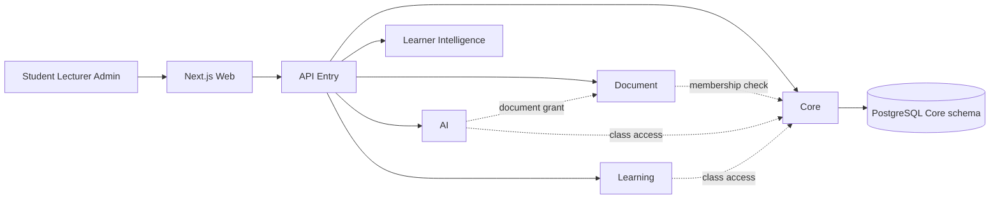

# Kiến trúc Microservices v1

**Trạng thái:** BASELINE THIẾT KẾ · **Ngày:** 2026-10-11

## 1. Cấu trúc và stack
**Một Monorepo**, năm Microservices. Next.js Web gọi các API có phiên bản. Core chạy FastAPI, PostgreSQL (SQLAlchemy/Alembic), Docker Compose. Mỗi service có image, API, dữ liệu và quy trình triển khai riêng; không có yêu cầu máy chủ vật lý riêng.

## 2. Ownership
| Service | Sở hữu dữ liệu |
|---|---|
| Core | User, Role, Session, School, AcademicYear, HomeroomClass/Roster, SubjectClass, TeachingAssignment, Membership, Feed, Comment, Calendar, Notification, Core audit/admin |
| Document | Library, File, DocumentVersion, ClassDocumentGrant, notes/bookmarks gắn nguồn |
| Learning | Practice, Assessment, Assignment, Attempt, Submission, Grade, deadline chính thức |
| AI | Conversation, Message, RAG index/retrieval metadata dẫn xuất |
| Learner Intelligence | Evidence, MasterySnapshot, Recommendation |

**Deadline:** Learning là nguồn chính thức, Core Calendar chỉ hiển thị bản chiếu; thay đổi deadline phải thông báo (L3). **Notes/bookmarks:** Document sở hữu, giữ ghi chú tự viết và che nguồn bị thu hồi (H6/L6/O2).

## 3. Giao tiếp và dữ liệu
- Core PostgreSQL schema `core`; các service dùng schema/credential riêng nếu dùng cùng PostgreSQL instance. Không foreign key hoặc SQL trực tiếp xuyên service.
- REST/HTTP JSON có version, OpenAPI, mã lỗi, correlation ID, pagination. Internal access-check bắt buộc service authentication, scope và kiểm tra quyền hiện hành.
- Event liên service cho dữ liệu dẫn xuất; transactional outbox ở nguồn cho sự kiện quan trọng, consumer idempotent và xử lý retry/out-of-order.
- Khi Core không xác minh được membership hoặc Document không xác minh được grant, thao tác nhạy cảm **fail closed**.
- Không log token, mật khẩu, chat riêng tư hay nguyên văn tài liệu. Admin can thiệp có audit, không mặc định có quyền đọc chat.
- Docker Compose là môi trường triển khai ban đầu, không mặc nhiên bảo đảm HA/zero downtime. CI GitHub Actions, health check và test unit/integration/contract cho từng service.

## 4. Luồng chính
1. Admin cấp Student và tạo roster lớp hành chính → Core đồng bộ ghi danh AUTO hoặc quản lý MANUAL → thông báo; không có join code trong MVP.
2. Lecturer chia sẻ tài liệu ở Document → xử lý phiên bản → AI chỉ truy hồi nguồn có grant hiện hành và lớp có quyền.
3. AI Tutor gắn lớp, trích dẫn nguồn tin cậy hoặc nói rõ thiếu căn cứ; archived không hỏi AI mới.
4. Learning lưu đề/attempt/grade/deadline, AI không quyết định điểm chính thức; phát event sửa điểm cho Learner Intelligence.
5. Learner Intelligence chỉ kết luận có bằng chứng; ẩn thống kê AI Tutor nhóm nhỏ theo O6.

## 5. Phạm vi thiết kế
**Core** có đặc tả chi tiết tại [DESIGN](core/DESIGN.md), [API](core/API_CONTRACT.md) và [FOLDER STRUCTURE](core/FOLDER_STRUCTURE.md). Bốn service còn lại được cố định **ranh giới nghiệp vụ và hợp đồng nguyên tắc**; tên bảng, endpoint, model, message broker và hạ tầng riêng sẽ nằm trong thiết kế của từng service khi triển khai. Không xem chúng là quyết định đã được chốt ở đây.

[Business Rules](../BUSINESS_RULES.md) · [ADR](ADR-001.md) · [Roadmap](IMPLEMENTATION_ROADMAP.md).

## Điều chỉnh miền sản phẩm Lumi
Phạm vi MVP: lớp chính khóa THCS/THPT (khối 6–12). `Student`/`Lecturer` trong sơ đồ là tên role kỹ thuật; UI dùng “Học sinh”/“Giáo viên”. Nhà trường nhận báo cáo thông qua Admin, không có tài khoản riêng. Kiến trúc năm service và ownership không thay đổi.

- **Core:** lớp môn học gắn môn, khối, năm học, lớp hành chính (nếu có); ghi danh AUTO/MANUAL do Admin quản lý, không dùng mã tham gia lớp; học sinh không tự rời lớp chính khóa. Classroom Admin/access API và schema có triển khai; tích hợp Social/Notification/Learning và mapping School legacy còn pending.
- **Document:** tài liệu và quyền chia sẻ tiếp tục theo lớp môn học; có thể lọc theo khối/môn qua metadata Core, không suy diễn quyền truy cập từ metadata.
- **AI:** hướng dẫn theo khối lớp, có giới hạn hỗ trợ trong kiểm tra chính thức; truy hồi và trích dẫn vẫn theo quyền hiện hành.
- **Learning:** Practice/Assessment/Assignment giữ phân biệt điểm; giáo viên chính phê duyệt công bố Assessment và sửa/hủy kết quả nhạy cảm; giáo viên phối hợp được chấm bài theo phân công.
- **Learner Intelligence:** phân tích theo bằng chứng, diễn đạt hỗ trợ học tập, tránh nhãn bất lợi đối với học sinh.

Việc triển khai yêu cầu cập nhật Core Design/API, migration và contract test; không xem ghi chú này là bằng chứng chức năng đã chạy.

## Tác động liên service (DECIDED nghiệp vụ; chi tiết event/API PROPOSED)
- Core sở hữu school/homeroom/subject class/roster, teaching assignment, enrollment mode, identity, transfer/archive; phát sự kiện versioned/idempotent khi membership/teacher assignment thay đổi.
- Document kiểm tra quyền nguồn hiện hành, kể cả khi Student có quyền đọc ghi chú hoặc hội thoại lịch sử; nguồn bị thu hồi không mở lại qua citation/bookmark.
- AI tách quyền đọc chat riêng tư của chủ chat, chia sẻ chủ động, và quyền hỏi RAG mới theo lớp ACTIVE + document grant; Admin/Lecturer không đọc chat mặc định.
- Learning giữ submissions/grades/appeals và trạng thái attempt khi chuyển lớp; giáo viên chính phê duyệt thao tác nhạy cảm, đồng giáo viên chỉ chấm theo phân công.
- Learner Intelligence tiêu thụ bằng chứng đã sửa/được xác nhận, không xóa lịch sử khi chuyển lớp; analytics nhóm nhỏ bảo vệ riêng tư.
- school_id là chuẩn bị multi-school, **không** có UI/role quản trị đa trường MVP; tenant boundary phải được kiểm tra backend.
