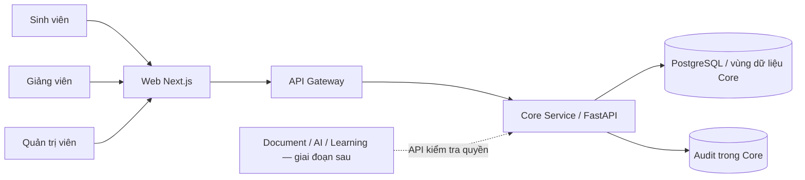
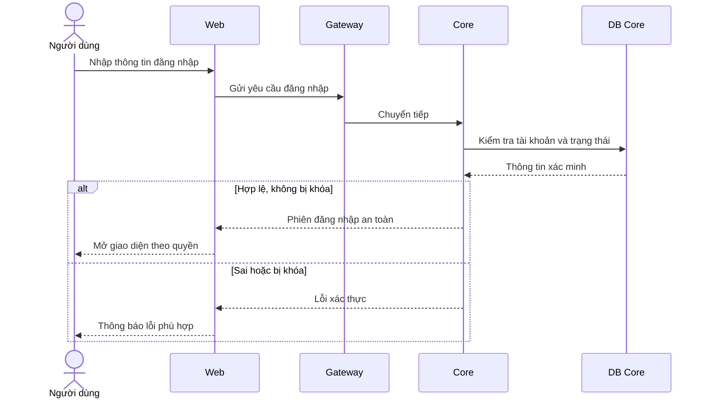
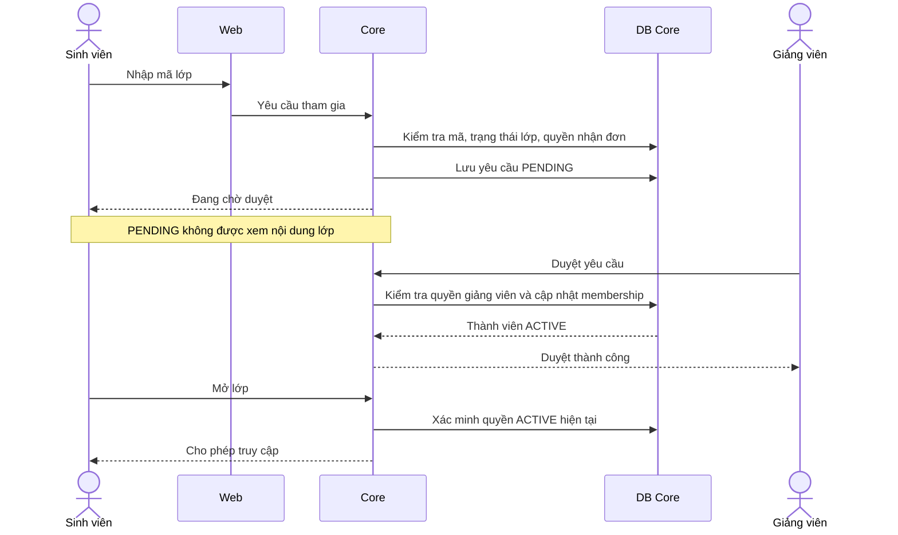

# Thiết kế Core Service — Bản dễ đọc

**Trạng thái:** [ĐỀ XUẤT] thiết kế kỹ thuật, chưa triển khai. **Ngày:** 11/10/2026.

**Nguồn nghiệp vụ:** [BUSINESS_RULES.md](../../BUSINESS_RULES.md) (đặc biệt A1–A6, F1–F2, F5, F7, H1–H2, K2, L2, M2, M5). Xem [lộ trình](../IMPLEMENTATION_ROADMAP.md) và [API contract](API_CONTRACT.md).

## 1. Core làm gì?
Core quản lý **người dùng, vai trò, lớp học, thành viên và quyền truy cập hiện tại**. Đây là một Microservice với nhiều module nội bộ, không phải nhiều service nhỏ. Các service Document, AI và Learning sau này **gọi API Core để xác minh quyền**, không đọc bảng Core trực tiếp.

Trong G1–G2 tập trung tài khoản, lớp, membership, đồng giảng viên, archive, audit quyền. Bảng tin, bình luận, lịch, thông báo, ghi chú, báo cáo quản trị đầy đủ vẫn nằm trong backlog MVP, không bị hủy.

## 2. Sơ đồ C4 Container (rút gọn) — [ĐỀ XUẤT]

*Chú thích:* FastAPI, Next.js, PostgreSQL, Gateway là [ĐỀ XUẤT]; đây là sơ đồ container logic, không biểu thị các máy chủ vật lý riêng.

## 3. Các module nội bộ — [ĐỀ XUẤT]
| Module | Trách nhiệm | Không làm |
|---|---|---|
| Identity | Xác thực, phiên, khóa tài khoản, hồ sơ | Không sở hữu điểm |
| Authorization | Kiểm tra vai trò và quyền theo lớp/tài nguyên | Không cho service khác đọc DB trực tiếp |
| Classroom | Môn/lớp, mã lớp, archive/restore | Không sở hữu tài liệu gốc |
| Membership | Yêu cầu tham gia, duyệt/từ chối, rời/loại, đồng giảng viên, chuyển chủ | Không xóa lịch sử học tập khi rời |
| Audit | Ghi hành động quản trị và thay đổi quyền | Không mặc định ghi nội dung riêng tư |

## 4. Mô hình dữ liệu logic — [ĐỀ XUẤT]
| Thực thể | Trường cốt lõi tham khảo | Ràng buộc |
|---|---|---|
| User | user_id, email, password_hash/identity_provider_id, status | Không lưu mật khẩu thuần; khóa tài khoản chặn truy cập (K2) |
| RoleAssignment | user_id, role | Admin/Lecturer/Student; quyền lớp còn phụ thuộc membership |
| Course | course_id, name | Một môn có nhiều lớp |
| Class | class_id, course_id, owner_lecturer_id, join_code, join_enabled, status | Giảng viên tạo lớp không cần Admin duyệt |
| ClassMembership | class_id, user_id, class_role, status | Chỉ thành viên được duyệt mới truy cập nội dung |
| JoinRequest | request_id, class_id, student_id, status, decided_by, decided_at | Chống yêu cầu chờ duyệt trùng; lịch sử quyết định |
| AuditEvent | audit_id, actor_id, action, target_id, timestamp, correlation_id | Ghi can thiệp và thay đổi quyền quan trọng |

Tên bảng/cột và kiểu dữ liệu **chưa chốt**. Cần xác định các ràng buộc duy nhất, giao dịch chuyển chủ lớp và xử lý cạnh tranh giữa duyệt/loại thành viên trước khi code.

## 5. Luồng đăng nhập — [ĐỀ XUẤT]

Không chốt JWT hay cookie trong sơ đồ; cách lưu phiên, CSRF và chính sách thu hồi phiên cần review bảo mật.

## 6. Luồng xin tham gia lớp và duyệt — [ĐỀ XUẤT]

Trong triển khai thực tế, Web và Gateway vẫn là đường đi của các request; sơ đồ rút gọn để tập trung nghiệp vụ.

## 7. Các trường hợp bắt buộc kiểm thử
1. Sinh viên PENDING hoặc bị loại không đọc được dữ liệu lớp (A1, L2).
2. Giảng viên lớp A không quản lý lớp B; Admin can thiệp có audit (A4, F2).
3. Giảng viên chính chuyển chủ cho đồng giảng viên trước khi rời; đồng giảng viên không tự chuyển chủ/xóa lớp (H1–H2, M2).
4. Lớp lưu trữ không nhận thành viên mới; khôi phục có audit (F5, M5).
5. Khóa tài khoản chặn truy cập hiện tại; không tự xóa dữ liệu (K2).
6. Duyệt/loại đồng thời không tạo hai membership hiệu lực trái ngược; cần giao dịch/khóa phù hợp.
7. Các API kiểm tra quyền dành cho service tương lai từ chối khi không xác minh được, không dựa vào metadata cũ.

## 8. Quyết định cần nhóm duyệt
Cơ chế xác thực (cookie/session hay JWT), mã lớp và giới hạn thử, schema/migration, phân quyền cấp API, trạng thái membership, định dạng audit, chính sách session và rate limiting. Các ví dụ ở đây **không phải implementation đã kiểm thử**.
