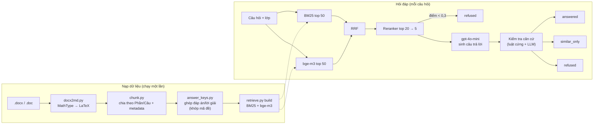

# Thiết kế prototype RAG Toán (ToanMathWord)

> **Phạm vi:** mô tả *thử nghiệm đã làm* trong `experiments/rag-toanmath/` để làm đầu vào cho thiết kế chính thức
> [TASK-018](../../tasks/TASK-018-ai-service-rag-tutor.md) (#23). Đây **không phải** thiết kế đã duyệt của AI Service:
> chưa có endpoint, schema DB, kiểm tra quyền, hay lựa chọn provider được nhóm chốt. Mục 8 liệt kê các quyết định cần nhóm duyệt.
>
> Người viết: TV3 (buivankhoi03) · Ngày: 2026-11-09 · PR: #41

## 1. Mục tiêu

Trả lời 3 câu hỏi trước khi thiết kế AI Service:

1. Lấy được nội dung Toán (công thức) từ tài liệu thật với chất lượng đủ dùng không?
2. Truy hồi (tìm đúng đoạn tài liệu) đạt mức nào với câu hỏi học sinh tự diễn đạt?
3. Có làm được câu trả lời **có trích dẫn, bám nguồn, biết từ chối** (Rule C1–C3) không, và tốn bao nhiêu?

Dữ liệu thử: 215 file Word đề thi lớp 6–12 tải từ ToanMath (xem `REPORT.md` của bộ dữ liệu). Không dùng dữ liệu người dùng thật.

## 2. Kiến trúc tổng quan

## 3. Nạp dữ liệu

### 3.1. Trích xuất công thức (`mtef.py`, `docx2md.py`)
- 178/191 file `.docx` lưu công thức bằng **MathType (OLE `Equation.DSMT4`)**. Thư viện đọc Word thông thường (python-docx, pandoc) làm mất các công thức này.
- Giải pháp: đọc stream `Equation Native` (định dạng MTEF v5) trong từng OLE object, dựng lại cây công thức, sinh LaTeX. Có xử lý record riêng của MathType 7 (độ dài 1 byte, `0xFF` → 16-bit), ký tự Unicode/Symbol, template (phân số, căn, tích phân, ngoặc, hệ phương trình, vectơ…).
- Công thức Word gốc (OMML) và bảng cũng được chuyển; ảnh/hình → `[HÌNH]`.
- `.doc` (24 file) chuyển sang `.docx` bằng Word trên máy trước.

| Kiểm chứng | Kết quả |
|---|---|
| Công thức MathType chuyển được | 21.622 / 21.657 (99,8%) |
| Khớp TeX gốc người soạn đã gõ (4.775 công thức có chú thích TeX) | **99,62%** |
| Soát bằng mắt 10 công thức phức tạp ngẫu nhiên so với ảnh gốc | 10/10 |

Bộ so khớp giữ nguyên dấu chấm thập phân/dấu nhân (`1.5` ≠ `15`); bản đầu xoá dấu chấm và tính nhầm 1 công thức là khớp (99,64% → 99,62%).

Lỗi đã biết: Word làm rỗng ~270 công thức khi chuyển `.doc` → `.docx`; ~870 ảnh dán (công thức dạng ảnh) mất nội dung.

### 3.2. Chia chunk (`chunk.py`)
- 1 chunk = 1 câu/bài (`**Câu N.**`, `Bài I`…), theo dõi `PHẦN I/II/III` vì đề mới đánh số câu lại từ đầu mỗi phần.
- Metadata: `lop`, `bo_de`, `file`, `kieu` (`de`/`dap_an`/`ma_tran`), `loai_de`, `nam_hoc`, `truong`, `phan`, `cau`.
- Mỗi bộ đề có nhiều mã đề gần giống nhau → chỉ giữ **1 mã đề chính** (`canonical`) để kết quả không bị trùng.
- Kết quả: 3.565 chunk, 2.597 chunk vào chỉ mục.

### 3.3. Ghép căn cứ đáp án (`answer_keys.py`, `retrieve.load`)
- Lời giải dạng chữ: ghép theo (bộ đề, phần, câu) **và chỉ khi khớp mã đề** (hoặc bộ đề chỉ có 1 file đề).
- Đáp án trắc nghiệm: đọc 4 kiểu bảng đáp án (hàng=mã đề, hàng=câu, `Câu|Đáp án`, hàng xen kẽ), cả bảng nằm cuối file đề.
- Kết quả: **450/2.375 câu (19%) có căn cứ đáp án** (156 lời giải chữ + 294 đáp án trắc nghiệm). Trước khi bắt khớp mã đề có **41 lời giải bị ghép nhầm**.

## 4. Truy hồi (`retrieve.py`)

| Bước | Cách làm |
|---|---|
| Văn bản đánh chỉ mục | `Lớp | loại đề | năm | trường` + nội dung câu + lời giải (nếu có) |
| Lọc | theo `lop` (mô phỏng lọc theo phạm vi tài liệu được cấp quyền); BM25 và dense chỉ xếp hạng trong tập được phép, tập rỗng → không trả kết quả (fail closed) |
| BM25 | tách từ thường + tách lệnh LaTeX thành từ (`\frac` → `frac`) |
| Dense | `BAAI/bge-m3`, chuẩn hoá vector, cosine |
| Kết hợp | Reciprocal Rank Fusion (k=60) trên top 50 mỗi bên |
| Rerank | `BAAI/bge-reranker-v2-m3` chấm lại top 20, lấy 5 |

Đánh giá trên 32 câu học sinh tự diễn đạt (đáp án = chunk gốc), có lọc lớp:

| Cách | Recall@1 | Recall@5 | MRR |
|---|---|---|---|
| BM25 | 78% | 88% | 0,83 |
| bge-m3 | 72% | 94% | 0,82 |
| RRF | 75% | 91% | 0,82 |
| **RRF + reranker** | **84%** | **97%** | **0,89** |

Số đo trước lần dựng lại embedding cuối (sau khi sửa ghép lời giải); chưa đo lại.

## 5. Sinh câu trả lời (`answer.py`)

- LLM: `gpt-4o-mini` (đổi qua `OPENAI_MODEL`), key đọc từ `.env`/biến môi trường, không có trong repo.
- 2 chế độ ứng với `AIConversation.mode`: `quick` (QUICK_QA), `step` (STEP_BY_STEP – gợi ý từng bước, không giải hộ).
- Prompt: 5 nguồn đánh số `[1]…[5]`, mỗi nguồn gắn nhãn **`CÓ LỜI GIẢI` / `CHỈ CÓ ĐỀ`** và vị trí (lớp · loại đề · trường · file · phần · câu).

### 5.1. Ba kết quả đầu ra
| `status` | Khi nào | Hiển thị cho học sinh |
|---|---|---|
| `answered` | Có căn cứ đáp án cho đúng bài | Câu trả lời + trích dẫn |
| `similar_only` | Tài liệu có bài cùng dạng nhưng không có lời giải | "Chưa có lời giải", liệt kê 3 bài tương tự để tự luyện |
| `refused` | Không có tài liệu liên quan | Nói rõ thiếu căn cứ (Rule C3) |

### 5.2. Chuỗi kiểm tra (fail closed)
1. Điểm reranker top-1 < **0,3** → `refused` (không gọi LLM, tiết kiệm chi phí).
2. LLM trả `KHONG_LIEN_QUAN` → `refused`; trả `CHI_CO_BAI_TUONG_TU` → `similar_only`.
3. Trích dẫn trỏ tới nguồn không tồn tại → `refused`; không có trích dẫn → `similar_only`. Bỏ qua phần LaTeX khi dò trích dẫn.
4. **Luật cứng:** mọi nguồn được trích đều `CHỈ CÓ ĐỀ` → `similar_only`.
5. **Luật cứng:** không có nguồn `CÓ LỜI GIẢI` nào được trích với điểm reranker ≥ **0,5** → `similar_only` (chặn dùng lời giải của bài khác).
6. LLM thứ hai (nhiệt độ 0, JSON) liệt kê từng khẳng định + nguồn căn cứ; khẳng định nào không trỏ tới nguồn có lời giải → `similar_only`. JSON lỗi → `similar_only`.

Luật 4–5 được thêm vì đánh giá cho thấy **LLM kiểm tra một mình không đủ tin cậy**: nó từng chấp nhận phương án trắc nghiệm, và lời giải của bài khác, làm căn cứ.

## 6. Kết quả đánh giá đầu–cuối (`eval_answers.py`)

`gpt-4o-mini`, 40 câu (32 có trong dữ liệu + 8 ngoài dữ liệu), chế độ `quick`, 2026-11-09:

| Chỉ số | Kết quả | Gần với chỉ số QAS-06 |
|---|---|---|
| Hành vi đúng tổng | **37/40 (92%)** | — |
| Từ chối đúng câu ngoài dữ liệu | **8/8 (100%)** | Từ chối đúng ≥ 90% |
| Trích dẫn chứa đúng nguồn | **29/32 (91%)** | Độ chính xác trích dẫn ≥ 90% |
| Câu được trả lời có nội dung sai (soát tay) | **0/7** | Groundedness ≥ 90% |
| Chi phí | ~2.000 token vào + ~80 token ra / câu (1–2 lần gọi) | — |

Các lỗi tìm ra nhờ đánh giá và đã sửa: lời giải ghép nhầm mã đề (dẫn tới đáp án phương sai sai công thức), `\sqrt[2022]` bị hiểu là trích dẫn `[2022]`, LLM gộp "không liên quan" với "chỉ có bài tương tự", bộ kiểm tra chấp nhận lời giải của bài khác.

**Giới hạn của số liệu:** 40 câu, 1 người viết, chỉ chế độ `quick` → **chưa đủ làm bằng chứng QAS-06** (yêu cầu ≥ 100 câu theo phương pháp được duyệt).

## 7. Đối chiếu với TASK-018

| Yêu cầu | Prototype | Ghi chú |
|---|---|---|
| C1–C3 bám nguồn, trích dẫn, không bịa | ✅ Có | Mục 5.2; trích dẫn là vị trí câu trong đề (chưa có `doc_id`/trang thật của Document Service) |
| C4 hai chế độ hỏi | ✅ Có | `quick` / `step` |
| B7/C5 kiểm tra quyền kép, chỉ truy hồi tài liệu có grant | ❌ Chưa | Chỉ lọc theo `lop`; cần Core access + Document active-grants |
| 0% rò rỉ xuyên lớp | ❌ Chưa đo | Cần dữ liệu nhiều lớp + grant |
| D6 tắt khi làm bài, H5 lớp lưu trữ | ❌ Chưa | Phụ thuộc Learning/Core |
| E5/F3 chat riêng tư, không log nội dung | ⚠️ Một phần | Prototype không lưu hội thoại; nhưng **câu hỏi được gửi sang OpenAI** |
| `AIConversation`/`AIMessage`/`VectorIndexMetadata` | ❌ Chưa | Không có DB |
| QAS-01/02 cô lập lỗi | ❌ Chưa | Không có service |

## 8. Quyết định cần nhóm duyệt

1. **Provider LLM:** dùng OpenAI (`gpt-4o-mini`) cho chat thật của học sinh? Cần xem điều khoản lưu/huấn luyện dữ liệu vì E5/F3; phương án khác: model chạy nội bộ.
2. **Embedding/reranker:** bge-m3 + bge-reranker-v2-m3 chạy CPU mất ~20–30 phút để đánh chỉ mục 2.600 chunk; triển khai cần GPU hoặc dịch vụ embedding.
3. **Vector store:** prototype dùng numpy trong RAM; bản thật cần store hỗ trợ lọc theo `class_id`/`document_version_id` (vd. pgvector trên Postgres đang dùng cho Core) — chưa chọn.
4. **Ngưỡng 0,3 / 0,5** chỉnh trên 40 câu; cần chỉnh lại trên bộ ≥ 100 câu.
5. **Chế độ `similar_only`** có được coi là "từ chối đúng" theo C3 không (vì nói rõ không có lời giải và chỉ trỏ bài tương tự)?
6. **Nguồn dữ liệu:** đề thi chỉ 19% có đáp án → cần SGK cho lý thuyết và lời giải; SGK Cánh Diều là PDF scan, đang chờ chọn công cụ OCR.

## 9. Việc tiếp theo đề xuất

1. Chốt OCR cho SGK (đang so Marker / Qwen2.5-VL / PaddleOCR-VL trên 17 trang khó), đưa SGK vào chỉ mục.
2. Mở rộng bộ đánh giá lên ≥ 100 câu (nhiều người viết), đo cả `step`, đo lại truy hồi sau khi dựng lại embedding.
3. Viết thiết kế chính thức AI Service theo mục 8 sau khi nhóm quyết định, rồi mới tạo `services/ai/`.

## Phụ lục: bản đồ file

| File | Vai trò |
|---|---|
| `mtef.py` | MathType MTEF v5 → LaTeX |
| `docx2md.py` | .docx → Markdown (chữ, bảng, MathType, OMML, ảnh) |
| `chunk.py` | Chia chunk theo câu + metadata |
| `answer_keys.py` | Đọc bảng đáp án trắc nghiệm |
| `retrieve.py` | Ghép căn cứ, BM25/bge-m3/RRF/reranker |
| `answer.py` | Sinh câu trả lời + chuỗi kiểm tra căn cứ |
| `eval_mtef.py`, `eval_retrieval.py`, `eval_answers.py` | Đánh giá 3 tầng |
| `eval_set.jsonl` | 40 câu đánh giá (câu hỏi tự viết + ID chunk) |
